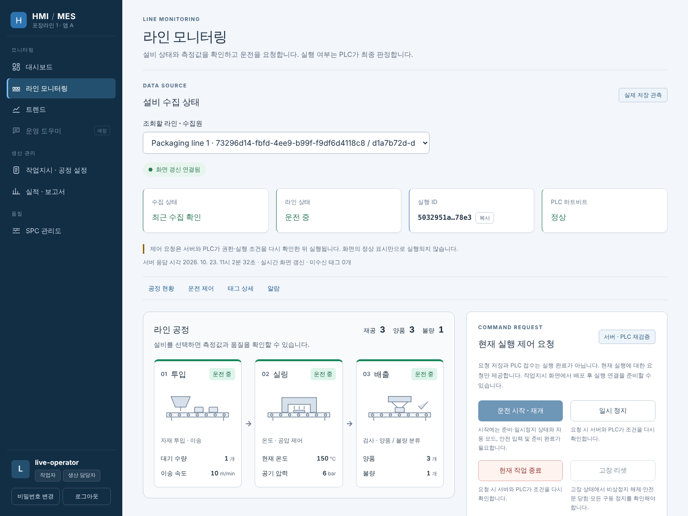
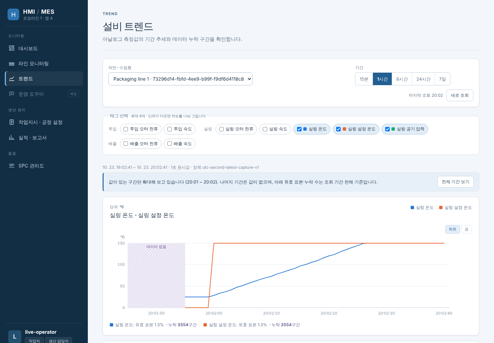
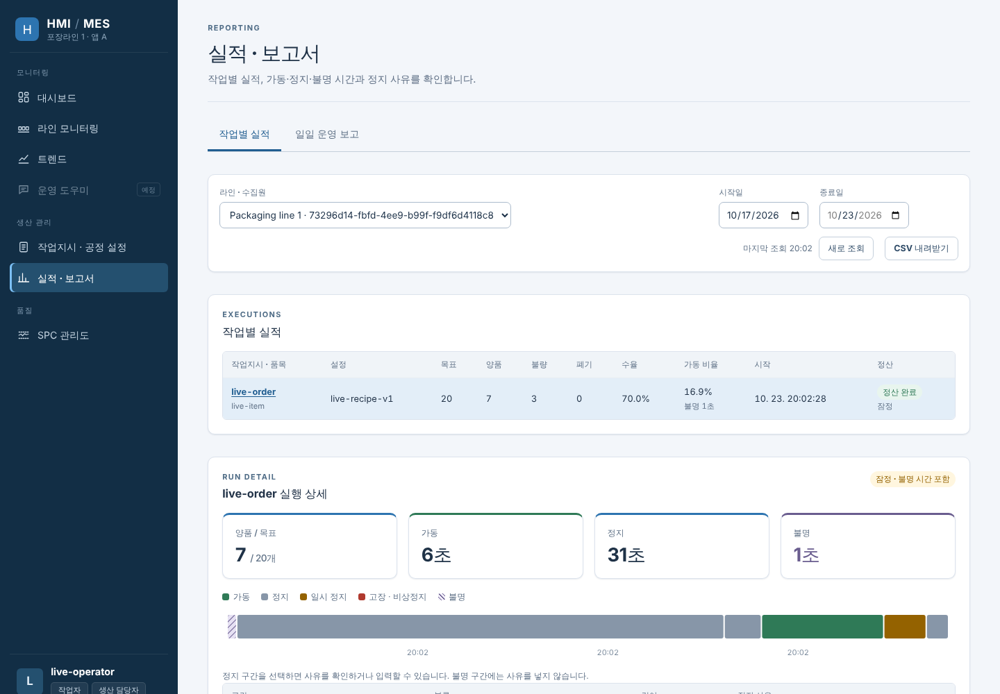
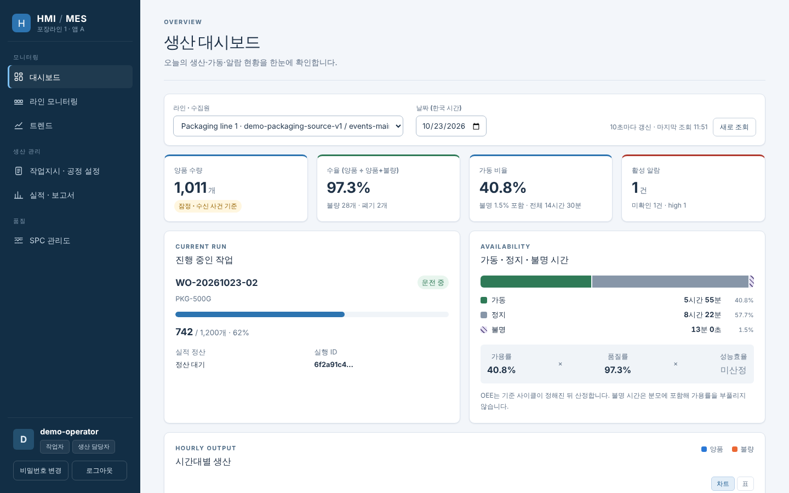
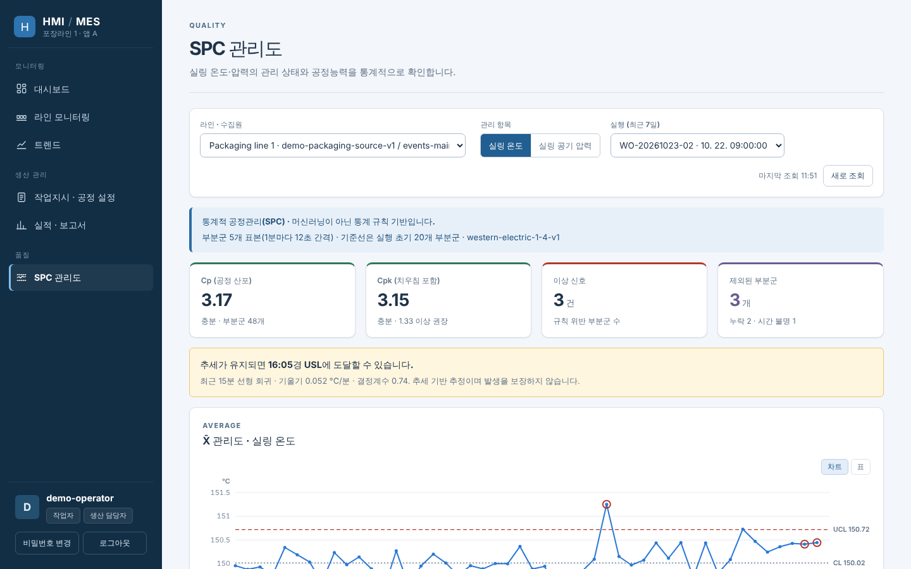
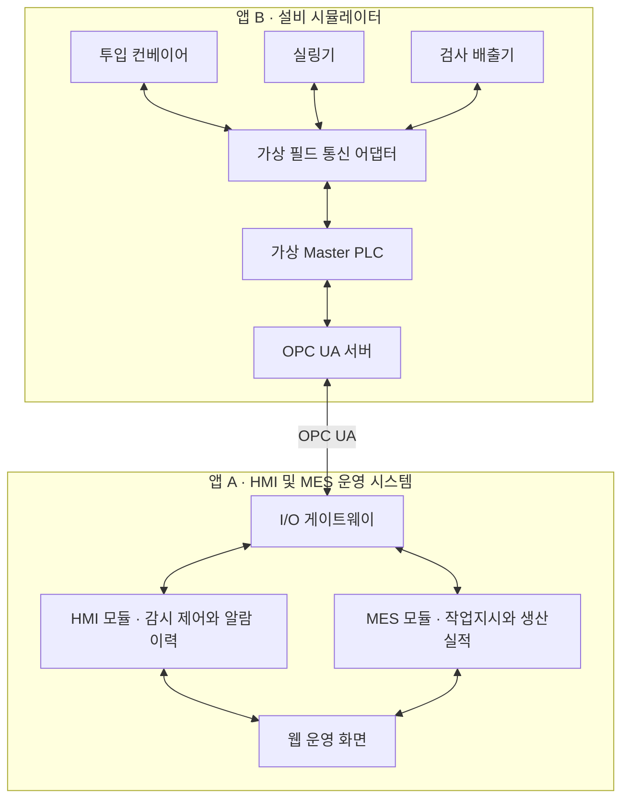

# HMI · MES 설비 운영 시스템

가상 포장라인 설비를 **실제 암호화 OPC UA**로 연결해 설비 감시·제어, 알람, 작업지시, 생산실적 정산까지 이어지는 스마트팩토리 운영 시스템입니다. 현장 설비는 독립 실행되는 **설비 시뮬레이터 앱(가상 PLC 포함)**으로 구현했고, 운영 시스템은 그 데이터를 수집해 웹 HMI·MES 화면으로 제공합니다.

**[포트폴리오 PDF (A4 가로 15쪽)](apps/web/public/portfolio/hmi-mes-portfolio.pdf)** · [구성과 촬영 범위](docs/HMI-MES-포트폴리오.md) — 2026-10-29 공개 배포를 실제 운전하며 촬영

KULS가 공개한 [HMI 시스템 구성예시](https://www.kuls.co.kr/ict/kict/ict_smartfactory_hmi.php)(현장설비 → Master PLC → OPC 서버 → HMI·MES 서버 → 모니터링)를 기준으로 각 계층의 역할을 직접 구현했습니다.



<sub>로컬 전체 경로 검증(`scripts/check-operable-system.py`) 중 실제 설비 앱이 생산하는 상태를 캡처했습니다. 모의 값이 아닙니다.</sub>

## 핵심 설계 포인트

| 현장 문제 | 이 프로젝트의 해결 |
|---|---|
| 버튼을 눌렀다고 설비가 실제로 움직였는지 알 수 없다 | 명령 **접수**와 **실행 결과**를 분리하고 원래 명령 ID로 결과를 추적합니다. 응답이 끊기면 같은 ID로 조회만 하고, 새 ID로 자동 재실행하지 않습니다. 실행 허용 여부는 가상 PLC가 최종 판정합니다. |
| 통신이 끊긴 동안의 값이 0이나 정상으로 보인다 | 측정값마다 원천·수집·저장 시각과 품질을 보관하고, 불명은 불명으로 표시합니다. 화면도 "불명"을 정상과 다른 색으로 구분합니다. |
| 재전송·재시작 때 실적이 두 번 잡힌다 | 생산 사건에 고유 ID와 원래 실행 ID를 붙여 중복 제거·실적·처리 커서를 한 트랜잭션에 저장합니다. 게이트웨이는 DB 커밋 ACK를 받은 뒤에만 버퍼를 비웁니다. |
| 작업 전환 때 이전 작업 수량이 다음 작업에 섞인다 | 종료 시 재공 정리와 설비 최종 요약 대조(정산)를 마친 뒤에만 다음 작업을 연결합니다. |
| 조회 권한 사용자도 제어할 수 있다 | 첫 제어 경로부터 세션·역할·CSRF·Origin 검사와 OPC UA 인증서 검증을 적용했습니다. |

## 화면

| 라인 모니터링 | 작업지시 · 공정 설정 |
|---|---|
| 공정도, 48개 태그와 품질, 운전 요청·원래 ID 추적, 실링기 아날로그 알람 | 공정 설정 버전·작업지시 등록, 배포, 라인 실행 연결, 미연결 작업 취소 |

대시보드·트렌드·실적 보고서·SPC 관리도는 서버 API와 결합해 로컬 실제 실행(생산 → 종료 → 정산 후 화면 조회, CSV 내려받기)으로 검증했습니다. 조회 전용 운영 도우미(챗봇, NVIDIA Nemotron)는 공개 배포에서 실제 모델 응답을 확인했습니다. 같은 호스트의 시계 근거를 켠 실행에서는 트렌드 값과 가동·정지·불명 시간이 실제로 계산됩니다. 근거가 없는 구간은 정상으로 바꾸지 않고 "불명"으로 남깁니다.

| 설비 트렌드 (실제 운전) | 실적 · 보고서 (실제 운전) |
|---|---|
|  |  |
| 1분 남짓의 운전이라 값이 있는 구간으로 자동 확대했습니다. 실링 온도가 설정값까지 오르는 곡선입니다. | 실행별 수량·정산과 가동·정지·불명 시간입니다. 시작 직후 근거가 없는 1초는 "불명"으로 남습니다. |
| **생산 대시보드 (미리보기)** | **SPC 관리도 (미리보기)** |
|  |  |

<sub>위 두 장은 로컬 실제 운전 화면입니다. 아래 두 장은 계약 형식의 **고정 데이터로 렌더링한 미리보기**입니다. 짧은 검증 운전으로는 하루 단위 대시보드가 대부분 "불명"으로 나오고, SPC 관리한계는 20분 이상의 부분군이 쌓여야 계산되기 때문입니다.</sub>

공개 화면(<https://hmi-mes.vercel.app>)에는 0018 이관과 원격 시계 측정이 적용되어 있습니다. 다만 기존 수집분은 측정 이전 데이터라 "시간 불명"으로 남고, 새 운전 데이터부터 시간이 계산됩니다([OPS-02 결과](docs/work-orders/reports/OPS-02.md)).

## 구현 현황

| 단계 | 상태 |
|---|---|
| M0 계약·기반 (48개 태그, 명령·사건·전송 계약, DB·인증 설계) | 해당 범위 검증 통과 |
| M1 설비 앱 (공정 모델, 가상 PLC, 명령 원장, SQLite 원자 저장, 인증 콘솔, OPC UA 서버) | 주요 경로 검증 통과, 전체 중단·복원 증적 남음 |
| M2 연동 (OPC UA → 게이트웨이 버퍼 → HTTP → PostgreSQL, 명령 전달, 최종 정산) | 실제 네트워크 경로 검증 통과, 장시간·복구 성능 측정 남음 |
| M3 HMI (인증, 실시간 화면, 운전 제어, 알람, 트렌드, 게스트 조회, 운영 도우미) | 구현·브라우저 검증, 로컬 시간 근거 결합 검증. 공개 화면의 새 데이터 시간 근거 실연 남음 |
| M4 MES (작업지시, 실행 연결·취소, 정산, 실적 보고·CSV, 정지 사유, SPC, 대시보드) | 구현·로컬 실제 결합 검증, 공개 배포(DB 0018) 적용 |
| M5 운영 (수락 시험 T01~T12, 성능, 장시간 운전, 백업·복원) | 일부 진행: T01~T12 분할 17개 통과(한 번에 묶은 실행 미실행), 백업 세트·별도 복원 검증. **30분 단절 후 5분 내 복구 실패**, 7일 이력 성능·깨끗한 빌드 릴리스 미실행, 8시간 운전 제외 |

**전체 프로젝트는 아직 완료되지 않았습니다.** 작은 작업 단위의 통과를 전체 완료로 표시하지 않으며, 세부 근거는 [개발 진행 상태](docs/DEVELOPMENT_STATUS.md)와 [수락 시험 대응표](docs/ACCEPTANCE_EVIDENCE.md)에 있습니다.

## 로컬 검증

CI 대신 저장소에 포함된 로컬 검사로 검증합니다. Docker(PostgreSQL)와 Chromium이 필요합니다.

```sh
./scripts/bootstrap-python.sh && ./scripts/bootstrap-web.sh && ./scripts/bootstrap-postgres.sh
./scripts/check-local.sh                                   # 린트·형식·Python 시험·웹 시험·타입 검사·빌드
VITE_SCREEN_TRANSPORT=polling VITE_ANALYTICS_PAGES=enabled npm --prefix apps/web run build
.venv/bin/python scripts/check-operable-system.py          # 브라우저 → API → PostgreSQL → 게이트웨이 → OPC UA → 정산
```

| 검사 | 최근 결과 |
|---|---|
| `check-local.sh` 전체 | 2026-10-23 통과(Codex 실행) — Python 2,354개, 웹 시험·타입 검사·린트·빌드 |
| `check-operable-system.py --analytics-dir …` | 2026-10-23 PASS — 같은 호스트 시계 근거로 실제 생산·정산 후 분석 화면 조회. 트렌드 GOOD 138점, 가동 6.4초, 정산 수량 일치 |
| `check-operable-system.py --guest-dir …` | 2026-10-23 PASS — 게스트 버튼 진입, 조회 전용, 쓰기 403 |
| `check-app-a-browser.py` | 2026-10-23 PASS — 로그인·권한·응답 유실 복구·작업지시·알람·취소 브라우저 시나리오 |

## 개발 방식

기획서·개발계획서·계약 문서로 기준을 먼저 고정하고, 구현은 AI 코딩 에이전트에 작은 작업 단위로 배정했습니다. 각 작업은 정해진 로컬 검사를 통과해야 다음 단계로 넘어가며, 미실행·실패는 통과로 기록하지 않습니다. 작업 규칙은 [AGENTS.md](AGENTS.md), 진행 기록은 [개발 진행 상태](docs/DEVELOPMENT_STATUS.md)에 있습니다.

## 문서

- 기준: [시스템 기획서](docs/HMI_MES_시스템_기획서_v1_0.md) · [개발계획서](docs/HMI_MES_개발계획서_v1_0.md) · [사용자 매뉴얼](docs/USER_MANUAL.md) · [작업자 사용 순서](docs/OPERATOR_GUIDE.md)
- 계약: [태그](contracts/tags/README.md) · [명령·사건 프로토콜](contracts/PROTOCOL.md) · [수집·ACK·화면 동기화](contracts/TRANSPORT.md) · [상태 전이](contracts/STATE_MACHINES.md)
- 설계: [DB·인증](docs/architecture/DATA_AUTH.md) · [PLC 운전 조건](docs/architecture/PLC.md) · [명령 원장](docs/architecture/COMMAND_STORE.md) · [시뮬레이터 OPC UA](docs/architecture/SIMULATOR_OPCUA.md) · [게이트웨이 OPC UA](docs/architecture/GATEWAY_OPCUA.md) · [정산](docs/architecture/SETTLEMENT.md)
- 실행: [게이트웨이·수집 API](docs/architecture/M2_RUN.md) · [앱 A 인증 서버](docs/architecture/API_RUN.md) · [설비 앱](docs/architecture/SIMULATOR_RUN.md) · [작업지시](docs/architecture/WORK_ORDERS.md) · [알람](docs/architecture/ALARM_RUN.md)
- 로컬 한 번에 실행: [Docker Compose](docs/architecture/COMPOSE_RUN.md) — `docker compose up -d` 후 `http://127.0.0.1:8002`에서 **로그인 없이 둘러보기(조회 전용)**
- 배포: [Neon·Vercel](deploy/neon-vercel.md) · [가상 설비 연결](deploy/plant-hosting.md) — 공개 화면 <https://hmi-mes.vercel.app> 의 설비·게이트웨이는 임시 클라우드 환경에서 실행하므로 상시 연결을 보장하지 않습니다.

## 1. 프로젝트 목표

- 설비 데이터 수집부터 화면 표시, 제어 요청과 실행 결과 확인까지 연결합니다.
- 고장 발생, 알람 확인, 원인 해소, 리셋과 재가동의 업무 흐름을 구현합니다.
- 작업지시와 설비의 생산 사건을 연결하여 작업별 실적과 정지 사유를 관리합니다.
- 통신 단절, 중복 수신, 앱 재시작, 작업 전환 상황에서 데이터의 일관성을 검증합니다.

## 2. 대상 공정

공장 1곳의 포장라인 1개를 기준으로, 세 설비를 순서대로 연결합니다.

| 설비 | 역할 | 주요 데이터 |
| --- | --- | --- |
| 투입 컨베이어 | 제품 공급과 투입 제어 | 운전 상태, 속도, 전류, 입구 센서, 대기 수량 |
| 실링기 | 온도와 운전 조건에 따른 포장 공정 | 온도, 설정값, 압력, 히터, 가드, 준비 상태 |
| 검사 배출기 | 제품 검사와 양품·불량 판정 | 검사 결과, 배출 센서, 양품·불량 카운터 |

각 제품에는 투입 당시의 작업 실행 ID를 부여하고 배출까지 유지합니다. 라인 안에 남아 있는 제품은 재공 수량으로 관리합니다.

## 3. 시스템 구성



### 공개 구성예시와의 대응

| 구성예시의 요소 | 프로젝트에서 구현할 요소 |
| --- | --- |
| 현장설비 | 설비 시뮬레이터의 세 설비 모델과 센서·구동기 상태 |
| 이더넷·Serial | 연결, 지연, 읽기 실패를 모사하는 가상 필드 통신 어댑터 |
| Master PLC | 운전 조건 판단, 공정 순서와 설비 상태를 관리하는 가상 PLC |
| OPC server | 태그, 명령과 사건 이력을 제공하는 OPC UA 서버 |
| HMI server 및 I/Q server 표기 | HMI 서버 모듈과 I/O 게이트웨이 |
| MES server | 작업지시, 실행, 실적과 정지 사유를 관리하는 MES 모듈 |
| InTouch 모니터링 | 직접 구현하는 웹 HMI |

OPC UA 채택과 포장라인 공정은 본 프로젝트의 설계 선택입니다. HMI와 MES는 초기에는 하나의 운영 백엔드 안에서 모듈로 구분하고, 수집과 명령 전달은 별도 I/O 게이트웨이가 담당합니다.

두 앱은 서로의 데이터베이스를 직접 읽거나 수정하지 않습니다. 앱 간 설비 연동은 실제 OPC UA 통신을 사용하고, 설비와 가상 PLC 사이의 필드 구간은 소프트웨어로 모사합니다.

## 4. 앱별 역할

### 앱 A — HMI 및 MES 운영 시스템

- 설비와 태그를 등록하고 OPC UA 데이터를 수집합니다.
- 공정도와 설비 상세 화면에 운전 상태, 측정값, 데이터 품질을 표시합니다.
- 운전 명령의 요청자, 전달 상태, 실행 결과와 거절 사유를 관리합니다.
- 알람 발생·복귀·확인·조치 이력과 태그 트렌드를 제공합니다.
- 작업지시, 공정 설정 버전, 생산실적, 정지 사유와 보고서를 관리합니다.
- 사용자 권한, 설정 변경 이력과 통신·복구 상태를 관리합니다.

### 앱 B — 설비 시뮬레이터

- 세 설비의 공정 진행과 센서·구동기 상태를 생성합니다.
- 가상 PLC가 운전 조건을 확인하고 실제 가상 설비 상태를 결정합니다.
- OPC UA 서버로 태그, 명령 접수, 결과 조회와 사건 이력을 제공합니다.
- 현장·원격 전환, 가드, 비상정지, 고장과 통신 단절을 조작하는 화면을 제공합니다.
- 작업 실행 상태, 재공, 생산 사건과 명령 처리 기록을 독립적으로 보관합니다.

두 앱은 각각 실행할 수 있어야 합니다. 본 시스템이 중단돼도 설비 앱은 정해진 현장 운전 규칙에 따라 동작하고, 설비 앱이 중단돼도 본 시스템의 기존 이력은 조회할 수 있도록 설계합니다.

## 5. 주요 기능

| 기능 | 구현 범위 |
| --- | --- |
| 설비·태그 관리 | 설비, 주소, 자료형, 단위, 수집 주기와 사용 여부 |
| 라인 HMI | 세 설비 공정도, 운전 모드, 현재 작업, 측정값과 연결 상태 |
| 운전 제어 | 시작, 일시정지, 정상종료, 설정 변경과 고장 리셋 |
| 알람 관리 | 발생·복귀, 확인자·확인 시각, 조치 메모와 심각도 |
| 트렌드·이력 | 복수 태그 비교, 기간 조회, 이상 전후 추세와 누락 구간 |
| 작업지시 | 품목, 목표 양품 수량, 라인과 공정 설정 버전 |
| 생산실적 | 양품·불량·재공 폐기, 중복 제거와 최종 수량 대조 |
| 정지·보고서 | 가동·정지·불명 시간, 정지 사유, 작업별 실적과 CSV |
| 운영 관리 | 권한 검사, 변경 이력, 수집 지연, 버퍼와 복구 상태 |

## 6. 기본 업무 흐름

1. 생산 담당자가 품목, 목표 수량과 공정 설정 버전으로 작업지시를 등록합니다.
2. 라인 정지, 재공 0과 이전 작업 종료를 확인한 뒤 새 작업을 설비에 연결합니다.
3. 가상 PLC가 작업 실행 ID와 설정을 수락하면 작업 준비를 완료합니다.
4. 작업자가 시작을 요청하고, PLC가 원격 모드·가드·고장·예열 등의 조건을 확인합니다.
5. 검사 배출기가 생산 사건을 생성하고, MES가 해당 작업의 실적에 반영합니다.
6. 고장이 발생하면 HMI 알람과 MES 정지 구간을 기록하고 작업자가 조치합니다.
7. 종료 요청 시 신규 투입을 중단하고 잔류 제품을 정리한 뒤 최종 수량을 대조합니다.
8. 대조가 완료되면 작업을 완료하고 다음 작업을 연결합니다.

## 7. 핵심 운영 규칙

### 제어 요청과 실행 결과

- 설비 상태와 명령 허용 여부는 가상 PLC가 최종 판단합니다.
- 명령 접수와 실행 성공을 구분하며, 화면은 실제 피드백으로 상태를 갱신합니다.
- 명령마다 고유 ID를 부여하고, 같은 ID와 같은 내용의 재전송에는 기존 결과를 반환합니다.
- 실행 여부가 불명확하면 원래 명령 ID로 결과를 확인하고, 만료된 명령은 실행하지 않습니다.

### 알람과 고장 조치

- 알람의 발생·복귀와 사용자의 확인 여부를 독립적으로 관리합니다.
- 알람 확인은 인지 기록이며, 고장 리셋은 설비에 별도 명령으로 요청합니다.
- 원인이 남아 있으면 리셋을 거절하고, 리셋 후 재가동은 사용자가 다시 요청합니다.

### 데이터 품질과 통신 단절

- 측정값과 함께 원천 시각, 수집 시각, 저장 시각과 품질을 보관합니다.
- 통신 단절 시 마지막 정상 값과 수집 시각을 표시하고, 현재 상태는 불명으로 처리합니다.
- 단절 구간을 값 0이나 정상 상태로 채우지 않으며, 보고서에도 불명 시간을 표시합니다.

### 생산실적과 작업 전환

- 생산 사건에는 고유 ID와 발생 당시의 작업 실행 ID를 기록합니다.
- 중복 사건은 한 번만 집계하고, 설비 카운터는 사건 합계와의 대조에 사용합니다.
- 작업 종료 시 투입 중단, 재공 정리, 최종 사건 수신과 수량 대조를 마친 뒤 다음 작업을 연결합니다.
- 앱 재시작 후에도 생산 사건과 명령 처리 기록을 유지하여 중복 반영을 방지합니다.

## 8. 기술 구성

| 영역 | 기술 |
| --- | --- |
| 웹 화면 | React 19, TypeScript, Vite, 직접 구현한 SVG 차트 |
| 운영 API | Python 3.12, FastAPI, SQLAlchemy, Alembic |
| OPC UA 서버·클라이언트 | asyncua (Basic256Sha256 서명·암호화, 인증서 검증) |
| 운영 데이터 저장 | PostgreSQL 17 (배포: Neon) |
| 설비 앱 상태·게이트웨이 버퍼 | 각 모듈의 별도 SQLite |
| 화면 데이터 전달 | HTTP API, WebSocket (Vercel 배포는 HTTP 폴링) |
| 검증 | pytest, Node test, Playwright(Chromium), 일회용 PostgreSQL 컨테이너 |

의존성 버전은 lockfile에 고정했습니다. 웹·API는 Vercel, 운영 DB는 Neon에 배치하고 설비 앱과 OPC 게이트웨이는 별도 장기 실행 프로세스로 유지합니다. 로컬에서는 [`docker compose up -d`](docs/architecture/COMPOSE_RUN.md) 한 명령으로 설비부터 화면까지 띄울 수 있습니다.

## 9. 개발 순서

- [x] 시스템 범위와 기획서 작성
- [x] 1단계 — 태그, 설비 상태, 명령과 생산 사건 계약 정의
- [x] 2단계 — 설비 시뮬레이터와 가상 PLC·OPC UA 서버 구현 (전체 중단·복원 증적 남음)
- [x] 3단계 — I/O 게이트웨이의 수집·저장·명령 전달 연결 (장시간·복구 성능 측정 남음)
- [ ] 4단계 — HMI, 설비 상세, 알람과 트렌드 구현 (트렌드 구현·결합 완료, 시간 근거 구성·통신 알람 남음)
- [ ] 5단계 — 작업지시, 생산실적, 정지 사유와 보고서 구현 (보고서·정지 사유·CSV 구현·결합 완료, 공개 배포 적용 남음)
- [ ] 6단계 — 장애 복구, 권한, 백업 복원과 통합 검증

체크한 단계도 남은 항목이 있으면 괄호에 적었습니다. 단계별 실제 검증 결과는 [개발 진행 상태](docs/DEVELOPMENT_STATUS.md)에 기록합니다.

## 10. 초기 검증 목표

### 검증 규모

| 항목 | 목표 |
| --- | --- |
| 설비 | 포장라인 1개, 가상 설비 3대 |
| 태그 | 48개 |
| 수집 주기 | 기본 1초 |
| 동시 사용자 | 10명 |
| 연속 운전 | 8시간 모의 운전 |
| 화면 반영 지연 | 정상 연결 시 PLC 변화부터 표시까지 p95 2초 이하 |

### 주요 수락 기준

- 정상 작업의 설정 버전, 생산 사건 합계와 설비 최종 수량이 일치합니다.
- 가드 개방, 현장 모드와 예열 미완료 등 조건 위반 시 시작을 거절합니다.
- 명령 응답 유실 후 원래 결과를 확인하며 중복 동작이 발생하지 않습니다.
- 알람 확인과 정상 복귀의 순서가 달라도 상태와 이력을 보존합니다.
- 통신 복구 후 중복·지연 사건을 처리해도 작업별 실적이 정확합니다.
- 작업 A의 생산 사건이 작업 B의 실적에 반영되지 않습니다.
- 앱 중단·재시작과 백업 복원 후 주요 상태와 기록을 대조할 수 있습니다.
- 조회 권한 사용자의 제어 요청을 서버에서 거절합니다.

## 11. 확장 방향

최초 완료 범위는 가상 설비와 실제 OPC UA 통신을 사용하는 HMI·MES 통합 검증입니다.

이후 장비와 운영 요구가 정해지면 다음 항목을 확장합니다.

- 실제 Modbus TCP·Serial 어댑터와 PLC 연결
- 여러 라인과 현장의 통합 운영
- 생산 달력과 기준 사이클이 확보된 이후 OEE·교대 분석
- 실제 정비·고장 데이터가 확보된 이후 유지보수 분석

## 12. 실행 안내

## 로컬 개발 환경

Python 3.12, uv, Node.js 22.12 이상인 22 LTS 또는 24 LTS, npm 10 이상을 사용한다. 전체 통합 시험에는 Linux의 로컬 Docker 데몬(`/var/run/docker.sock`)과 PostgreSQL 이미지가 필요하다. 직접 의존성 버전과 전체 해석 결과는 `pyproject.toml`·`uv.lock`, `apps/web/package.json`·`package-lock.json`에 고정한다.

저장소 루트에서 실행한다.

```sh
./scripts/bootstrap-python.sh
./scripts/bootstrap-web.sh
./scripts/bootstrap-postgres.sh
./scripts/check-local.sh
```

Python 환경은 `.venv`, 기본 설치 캐시는 `.cache`에 생성된다. 설치 스크립트는 기존 lockfile을 사용하며, 제공된 프록시와 CA 신뢰 설정을 유지한다.

개별 검증:

```sh
./scripts/check-python.sh lint
./scripts/check-python.sh test
.venv/bin/python contracts/tags/validate.py
```

검사 명령은 실패를 그대로 반환하며 시험이 하나도 수집되지 않은 상태도 성공으로 처리하지 않는다. 위 명령은 현재 구현된 검증만 실행하며, T01~T12나 장시간 성능 시험 전체를 대신하지 않는다.

## 통신·DB 기반 확인

```sh
.venv/bin/python scripts/opcua_poc.py
.venv/bin/python scripts/probe-postgres.py
```

OPC UA PoC는 별도 로컬 서버 프로세스에서 실제 암호화 통신을 검증한다. 명령은 `POC_ONLY`로 거절하며 실제 운전은 수행하지 않는다. [검증 범위](docs/architecture/OPCUA_POC.md)에 인증서 시험과 제한을 기록했다.

PostgreSQL 확인에는 로컬 Docker 데몬과 고정된 PostgreSQL 이미지 접근이 필요하다. 임시 비밀번호와 임시 컨테이너로 인증 연결·정밀도·제약·롤백을 확인한 뒤 회수한다. 업무 DB 스키마와 백업·복원 시험을 대신하지 않는다.

현재 DB 마이그레이션·기준 정보 등록은 별도 `HMI_DATABASE_DSN` 런타임 변수를 사용한다. `.env.example`의 다른 DB 필드를 조합하는 서비스 설정 로더는 아직 미구현이다. 실제 DB에 적용하기 전 [초기 DB 구성 절차](docs/architecture/DATABASE_BOOTSTRAP.md)를 따른다.

## 앱 A 웹 개발 기반 실행

```sh
cd apps/web
npm run dev
```

앱 A에는 로그인·초기 비밀번호 변경, WebSocket으로 갱신하는 48개 태그·공정도, 역할별 운전 요청과 원래 ID 결과 추적을 제공한다. 통신 지연·품질 불명·미수신을 구별한다. 작업지시 등록·배포·실행 연결과 알람 확인·메모의 API 및 결합 브라우저를 검증했다. 정산된 실행의 기록 보관/다음 작업 준비 화면은 후속 검증 중이다. 트렌드·보고·후속 MES 업무와 전체 수락 조건은 아직 완료하지 않았다. 사용자 API와 빌드 화면을 함께 실행하는 절차는 [앱 A 실행](docs/architecture/API_RUN.md), 개발·빌드 명령은 [웹 README](apps/web/README.md)를 참고한다.

게이트웨이는 기본 수집 외에 `--enable-commands`로 명령 추적, `--enable-settlement`로 원래 실행의 최종 요약 대조를 명시적으로 켠다. 두 기능의 접수·결과 불명·정산 보류를 성공으로 치환하지 않는다. [연동 실행 절차](docs/architecture/M2_RUN.md)와 [현재 검증 상태](docs/DEVELOPMENT_STATUS.md)를 확인한다.

별도 앱 B에는 로그인·비밀번호 변경·복구·가상 센서 조작·실제 명령 추적·생산 수량과 물품 위치·현장 대조 화면을 제공한다. [설비 앱 실행 절차](docs/architecture/SIMULATOR_RUN.md)로 시작하고 [콘솔 UI와 검증 범위](docs/architecture/SIMULATOR_CONSOLE_UI.md)를 확인한다. 앱 B의 로컬 대조는 앱 A MES 정산 완료를 뜻하지 않는다.


실링기 아날로그 알람의 규칙 등록과 수집 연결은 [알람 실행 절차](docs/architecture/ALARM_RUN.md)에 따라 명시적으로 설정한다. 수집 시각의 신뢰 근거가 없으면 불명으로 유지하며, 설치 기록만으로 감시 중이라고 단정하지 않는다. 실제 통신 경로와 개별 검증의 범위는 [개발 진행 상태](docs/DEVELOPMENT_STATUS.md)에 기록한다.

## 13. 참고 자료

- [KULS HMI 솔루션 소개](https://www.kuls.co.kr/ict/kict/ict_smartfactory_hmi.php)
- [KULS HMI 시스템 구성예시](https://www.kuls.co.kr/ict/inc/themes/kweb/img/hmi-sec2-system.png)
- [OPC Foundation — DataValue](https://reference.opcfoundation.org/specs/OPC-10000-4/7.11)
- [Ignition — Alarming](https://docs.inductiveautomation.com/docs/8.3/platform/alarming)
- [FreeOpcUa — asyncua](https://github.com/FreeOpcUa/opcua-asyncio)
