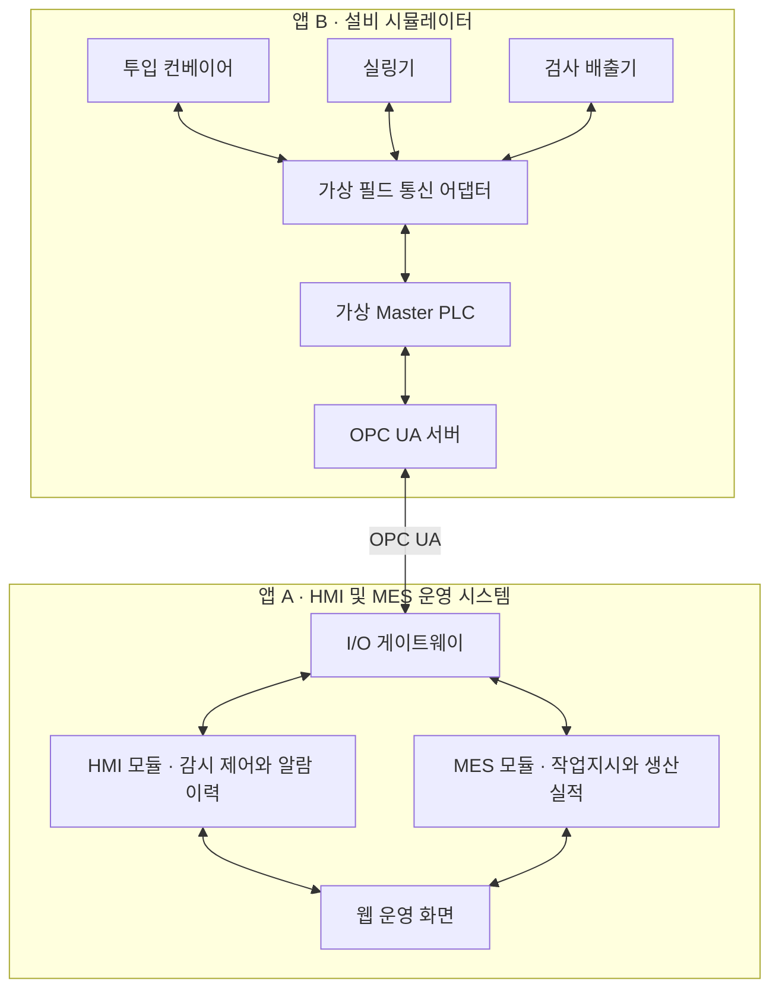

# HMI · MES 설비 운영 시스템

가상 설비와 OPC UA 통신으로 연결하여 **설비 감시·제어, 알람, 이력 조회, 작업지시와 생산실적 관리**를 구현하는 프로젝트입니다.

현장 하드웨어는 독립적으로 실행되는 **설비 시뮬레이터 앱**으로 구현합니다. 본 시스템은 이 앱에서 설비 데이터를 수집하고 운전 명령을 전달하며, 실제 실행 결과를 확인합니다.

KULS가 공개한 HMI 시스템 구성예시를 참고하여 현장설비, 통신 구간, Master PLC, OPC 서버, HMI·MES 서버, 모니터링 화면의 역할을 반영했습니다.

> **진행 상태: 기획 완료 · 구현 예정**  
> 아래 기능과 기술 구성은 개발 계획이며, 검증 수치는 개발 후 확인할 목표값입니다.

## 1. 프로젝트 목표

- 설비 데이터 수집부터 화면 표시, 제어 요청과 실행 결과 확인까지 연결합니다.
- 고장 발생, 알람 확인, 원인 해소, 리셋과 재가동의 업무 흐름을 구현합니다.
- 작업지시와 설비의 생산 사건을 연결하여 작업별 실적과 정지 사유를 관리합니다.
- 통신 단절, 중복 수신, 앱 재시작, 작업 전환 상황에서 데이터의 일관성을 검증합니다.

## 2. 대상 공정

공장 1곳의 포장라인 1개를 기준으로, 세 설비를 순서대로 연결합니다.

| 설비 | 역할 | 주요 데이터 |
| --- | --- | --- |
| 투입 컨베이어 | 제품 공급과 투입 제어 | 운전 상태, 속도, 전류, 입구 센서, 대기 수량 |
| 실링기 | 온도와 운전 조건에 따른 포장 공정 | 온도, 설정값, 압력, 히터, 가드, 준비 상태 |
| 검사 배출기 | 제품 검사와 양품·불량 판정 | 검사 결과, 배출 센서, 양품·불량 카운터 |

각 제품에는 투입 당시의 작업 실행 ID를 부여하고 배출까지 유지합니다. 라인 안에 남아 있는 제품은 재공 수량으로 관리합니다.

## 3. 시스템 구성

### 공개 구성예시와의 대응

| 구성예시의 요소 | 프로젝트에서 구현할 요소 |
| --- | --- |
| 현장설비 | 설비 시뮬레이터의 세 설비 모델과 센서·구동기 상태 |
| 이더넷·Serial | 연결, 지연, 읽기 실패를 모사하는 가상 필드 통신 어댑터 |
| Master PLC | 운전 조건 판단, 공정 순서와 설비 상태를 관리하는 가상 PLC |
| OPC server | 태그, 명령과 사건 이력을 제공하는 OPC UA 서버 |
| HMI server 및 I/Q server 표기 | HMI 서버 모듈과 I/O 게이트웨이 |
| MES server | 작업지시, 실행, 실적과 정지 사유를 관리하는 MES 모듈 |
| InTouch 모니터링 | 직접 구현하는 웹 HMI |

OPC UA 채택과 포장라인 공정은 본 프로젝트의 설계 선택입니다. HMI와 MES는 초기에는 하나의 운영 백엔드 안에서 모듈로 구분하고, 수집과 명령 전달은 별도 I/O 게이트웨이가 담당합니다.

두 앱은 서로의 데이터베이스를 직접 읽거나 수정하지 않습니다. 앱 간 설비 연동은 실제 OPC UA 통신을 사용하고, 설비와 가상 PLC 사이의 필드 구간은 소프트웨어로 모사합니다.

## 4. 앱별 역할

### 앱 A — HMI 및 MES 운영 시스템

- 설비와 태그를 등록하고 OPC UA 데이터를 수집합니다.
- 공정도와 설비 상세 화면에 운전 상태, 측정값, 데이터 품질을 표시합니다.
- 운전 명령의 요청자, 전달 상태, 실행 결과와 거절 사유를 관리합니다.
- 알람 발생·복귀·확인·조치 이력과 태그 트렌드를 제공합니다.
- 작업지시, 공정 설정 버전, 생산실적, 정지 사유와 보고서를 관리합니다.
- 사용자 권한, 설정 변경 이력과 통신·복구 상태를 관리합니다.

### 앱 B — 설비 시뮬레이터

- 세 설비의 공정 진행과 센서·구동기 상태를 생성합니다.
- 가상 PLC가 운전 조건을 확인하고 실제 가상 설비 상태를 결정합니다.
- OPC UA 서버로 태그, 명령 접수, 결과 조회와 사건 이력을 제공합니다.
- 현장·원격 전환, 가드, 비상정지, 고장과 통신 단절을 조작하는 화면을 제공합니다.
- 작업 실행 상태, 재공, 생산 사건과 명령 처리 기록을 독립적으로 보관합니다.

두 앱은 각각 실행할 수 있어야 합니다. 본 시스템이 중단돼도 설비 앱은 정해진 현장 운전 규칙에 따라 동작하고, 설비 앱이 중단돼도 본 시스템의 기존 이력은 조회할 수 있도록 설계합니다.

## 5. 주요 기능

| 기능 | 구현 범위 |
| --- | --- |
| 설비·태그 관리 | 설비, 주소, 자료형, 단위, 수집 주기와 사용 여부 |
| 라인 HMI | 세 설비 공정도, 운전 모드, 현재 작업, 측정값과 연결 상태 |
| 운전 제어 | 시작, 일시정지, 정상종료, 설정 변경과 고장 리셋 |
| 알람 관리 | 발생·복귀, 확인자·확인 시각, 조치 메모와 심각도 |
| 트렌드·이력 | 복수 태그 비교, 기간 조회, 이상 전후 추세와 누락 구간 |
| 작업지시 | 품목, 목표 양품 수량, 라인과 공정 설정 버전 |
| 생산실적 | 양품·불량·재공 폐기, 중복 제거와 최종 수량 대조 |
| 정지·보고서 | 가동·정지·불명 시간, 정지 사유, 작업별 실적과 CSV |
| 운영 관리 | 권한 검사, 변경 이력, 수집 지연, 버퍼와 복구 상태 |

## 6. 기본 업무 흐름

1. 생산 담당자가 품목, 목표 수량과 공정 설정 버전으로 작업지시를 등록합니다.
2. 라인 정지, 재공 0과 이전 작업 종료를 확인한 뒤 새 작업을 설비에 연결합니다.
3. 가상 PLC가 작업 실행 ID와 설정을 수락하면 작업 준비를 완료합니다.
4. 작업자가 시작을 요청하고, PLC가 원격 모드·가드·고장·예열 등의 조건을 확인합니다.
5. 검사 배출기가 생산 사건을 생성하고, MES가 해당 작업의 실적에 반영합니다.
6. 고장이 발생하면 HMI 알람과 MES 정지 구간을 기록하고 작업자가 조치합니다.
7. 종료 요청 시 신규 투입을 중단하고 잔류 제품을 정리한 뒤 최종 수량을 대조합니다.
8. 대조가 완료되면 작업을 완료하고 다음 작업을 연결합니다.

## 7. 핵심 운영 규칙

### 제어 요청과 실행 결과

- 설비 상태와 명령 허용 여부는 가상 PLC가 최종 판단합니다.
- 명령 접수와 실행 성공을 구분하며, 화면은 실제 피드백으로 상태를 갱신합니다.
- 명령마다 고유 ID를 부여하고, 같은 ID와 같은 내용의 재전송에는 기존 결과를 반환합니다.
- 실행 여부가 불명확하면 원래 명령 ID로 결과를 확인하고, 만료된 명령은 실행하지 않습니다.

### 알람과 고장 조치

- 알람의 발생·복귀와 사용자의 확인 여부를 독립적으로 관리합니다.
- 알람 확인은 인지 기록이며, 고장 리셋은 설비에 별도 명령으로 요청합니다.
- 원인이 남아 있으면 리셋을 거절하고, 리셋 후 재가동은 사용자가 다시 요청합니다.

### 데이터 품질과 통신 단절

- 측정값과 함께 원천 시각, 수집 시각, 저장 시각과 품질을 보관합니다.
- 통신 단절 시 마지막 정상 값과 수집 시각을 표시하고, 현재 상태는 불명으로 처리합니다.
- 단절 구간을 값 0이나 정상 상태로 채우지 않으며, 보고서에도 불명 시간을 표시합니다.

### 생산실적과 작업 전환

- 생산 사건에는 고유 ID와 발생 당시의 작업 실행 ID를 기록합니다.
- 중복 사건은 한 번만 집계하고, 설비 카운터는 사건 합계와의 대조에 사용합니다.
- 작업 종료 시 투입 중단, 재공 정리, 최종 사건 수신과 수량 대조를 마친 뒤 다음 작업을 연결합니다.
- 앱 재시작 후에도 생산 사건과 명령 처리 기록을 유지하여 중복 반영을 방지합니다.

## 8. 기술 구성안

| 영역 | 제안 기술 |
| --- | --- |
| 웹 화면 | React, TypeScript |
| 운영 API | Python, FastAPI |
| OPC UA 서버·클라이언트 | Python, asyncua |
| 운영 데이터 저장 | PostgreSQL |
| 설비 앱 상태·게이트웨이 버퍼 | 각 모듈의 별도 SQLite |
| 화면 데이터 전달 | HTTP API, WebSocket |
| 로컬 실행·검증 | Docker Compose, 로컬 시험 스크립트 |

패키지 버전은 초기 연동 검증 후 고정합니다. 현재 기술 구성은 제안안이며, 개발과 검증은 로컬 환경을 기준으로 진행합니다.

## 9. 개발 순서

- [x] 시스템 범위와 기획서 작성
- [ ] 1단계 — 태그, 설비 상태, 명령과 생산 사건 계약 정의
- [ ] 2단계 — 설비 시뮬레이터와 가상 PLC·OPC UA 서버 구현
- [ ] 3단계 — I/O 게이트웨이의 수집·저장·명령 전달 연결
- [ ] 4단계 — HMI, 설비 상세, 알람과 트렌드 구현
- [ ] 5단계 — 작업지시, 생산실적, 정지 사유와 보고서 구현
- [ ] 6단계 — 장애 복구, 권한, 백업 복원과 통합 검증

각 단계의 결과를 확인한 뒤 다음 단계로 진행합니다. 구현 상태와 실제 검증 결과는 개발 진행에 맞춰 이 문서에 갱신합니다.

## 10. 초기 검증 목표

### 검증 규모

| 항목 | 목표 |
| --- | --- |
| 설비 | 포장라인 1개, 가상 설비 3대 |
| 태그 | 48개 |
| 수집 주기 | 기본 1초 |
| 동시 사용자 | 10명 |
| 연속 운전 | 8시간 모의 운전 |
| 화면 반영 지연 | 정상 연결 시 PLC 변화부터 표시까지 p95 2초 이하 |

### 주요 수락 기준

- 정상 작업의 설정 버전, 생산 사건 합계와 설비 최종 수량이 일치합니다.
- 가드 개방, 현장 모드와 예열 미완료 등 조건 위반 시 시작을 거절합니다.
- 명령 응답 유실 후 원래 결과를 확인하며 중복 동작이 발생하지 않습니다.
- 알람 확인과 정상 복귀의 순서가 달라도 상태와 이력을 보존합니다.
- 통신 복구 후 중복·지연 사건을 처리해도 작업별 실적이 정확합니다.
- 작업 A의 생산 사건이 작업 B의 실적에 반영되지 않습니다.
- 앱 중단·재시작과 백업 복원 후 주요 상태와 기록을 대조할 수 있습니다.
- 조회 권한 사용자의 제어 요청을 서버에서 거절합니다.

## 11. 확장 방향

최초 완료 범위는 가상 설비와 실제 OPC UA 통신을 사용하는 HMI·MES 통합 검증입니다.

이후 장비와 운영 요구가 정해지면 다음 항목을 확장합니다.

- 실제 Modbus TCP·Serial 어댑터와 PLC 연결
- 여러 라인과 현장의 통합 운영
- 생산 달력과 기준 사이클이 확보된 이후 OEE·교대 분석
- 실제 정비·고장 데이터가 확보된 이후 유지보수 분석

## 12. 실행 안내

현재는 기획 단계입니다. 실행 명령, 환경변수와 초기 데이터 준비 방법은 초기 구현 완료 후 추가합니다.

## 13. 참고 자료

- [KULS HMI 솔루션 소개](https://www.kuls.co.kr/ict/kict/ict_smartfactory_hmi.php)
- [KULS HMI 시스템 구성예시](https://www.kuls.co.kr/ict/inc/themes/kweb/img/hmi-sec2-system.png)
- [OPC Foundation — DataValue](https://reference.opcfoundation.org/specs/OPC-10000-4/7.11)
- [Ignition — Alarming](https://docs.inductiveautomation.com/docs/8.3/platform/alarming)
- [FreeOpcUa — asyncua](https://github.com/FreeOpcUa/opcua-asyncio)
