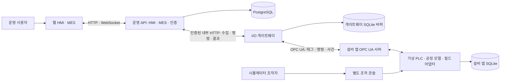

# HMI-MES 개발계획서

버전 1.0 · 작성일 2026년 10월 20일

## 1. 목적과 기준 문서

포장라인의 설비 데이터를 수집하고, 웹 HMI에서 상태 확인과 운전 명령을 요청하며, MES에서 작업지시별 실적과 정지 사유를 관리하는 시스템을 개발한다. 설비는 독립 실행되는 시뮬레이터 앱으로 구현하고, 운영 시스템과 실제 OPC UA 통신으로 연결한다.

이 문서는 아래 자료의 요구사항을 구현 단위, 개발 순서, 산출물, 검증 기준으로 구체화한다.

- [README](../README.md): 프로젝트의 목적과 두 앱의 기본 범위.
- [HMI-MES 시스템 기획서 v1.0](HMI_MES_시스템_기획서_v1_0.md): 기능 F01~F10, 수락 시험 T01~T12, 데이터·제어·복구 규칙.

작성 시점의 저장소에는 README와 기획 문서가 있으며 애플리케이션 소스, 의존성 정의, 실행 구성, 자동화 시험은 아직 없다. 아래 구조와 작업은 앞으로 구현할 계획이다. 이 문서의 완료 기준은 시험 통과 실적을 의미하지 않는다.

기획서의 요구사항을 기준으로 삼고, 라이브러리·폴더 구조·내부 API 등 이 문서에서 추가한 설계는 초기 구현안으로 관리한다. 구현 과정에서 변경이 필요하면 영향받는 요구사항과 시험을 함께 기록한다.

## 2. 개발 목표와 범위

### 2.1 최초 릴리스 목표

| 항목 | 목표 |
|---|---|
| 대상 | 공장 1곳, 포장라인 1개 |
| 가상 설비 | 투입 컨베이어, 실링기, 검사 배출기 각 1대 |
| 연동 | 가상 Master PLC 1개, OPC UA 서버 1개, 독립 I/O 게이트웨이 |
| 수집 | 48개 태그를 기본 1초 주기로 묶어서 읽기 |
| 사용자 | 동시 사용자 10명, 역할에 따른 조회·작업·관리 권한 |
| 주요 업무 | 운전 감시와 명령, 알람과 조치, 트렌드, 작업지시·설정, 실적·정지·보고서 |
| 운영 | 재시작·재전송·누락 복구, 감사 이력, 백업·복원, 설치·운영 문서 |
| 완료 수준 | 두 앱을 통한 T01~T12 및 성능·복구 목표 검증 |

### 2.2 후속 개발 범위

실제 PLC, Modbus TCP·Serial 어댑터, 다중 라인·현장, OEE·교대 분석, 생산계획 최적화, BOM·구매·원가, WMS, 3D 시뮬레이션, AI 예측, 이중화는 후속 과제로 둔다. 실제 장비 접근이나 태그맵 확보는 이번 가상 설비 개발의 선행 조건이 아니다.

OEE와 교대 분석은 생산 달력, 이상적 사이클, 교대 시간표와 수량 기준이 합의된 뒤 착수한다. 실제 장비 지원 여부는 해당 장비를 연결해 검증한 범위로만 표시한다.

## 3. 구현 구조와 기술 선택

### 3.1 프로세스와 책임



앱 A는 웹, 운영 API, I/O 게이트웨이, PostgreSQL로 구성한다. HMI와 MES 업무는 하나의 운영 API 안에서 모듈로 구분한다. 게이트웨이는 별도 프로세스이며, OPC UA 접근은 이 프로세스가 담당한다. 앱 B는 설비 모델, 가상 PLC, OPC UA 서버, 조작 콘솔, 자체 SQLite를 포함한다.

두 앱은 데이터베이스와 메모리를 직접 공유하지 않는다. 앱 A와 B의 설비 데이터·명령 교환은 OPC UA 계약을 따른다. 시험 도구는 앱 B의 조작 인터페이스로 고장과 통신 장애를 주입할 수 있지만, 운영 앱의 제어 경로는 이를 우회하지 않는다.

운영 API와 게이트웨이 사이에는 인증된 내부 HTTP 인터페이스를 우선 사용한다. API는 명령을 영속 저장하고, 게이트웨이는 대기 명령을 가져와 전달한 뒤 결과를 보고한다. WebSocket은 화면 갱신에 사용하며 명령과 사건의 영속 저장을 대신하지 않는다.

### 3.2 기술 구성안

| 영역 | 초기 선택 | 확정 조건 |
|---|---|---|
| 운영 화면 | React, TypeScript, Vite | HMI 공정도·표·실시간 갱신과 기본 빌드 확인 |
| 운영 API | Python, FastAPI, Pydantic | HTTP·WebSocket·입력 검증·인증 흐름 확인 |
| 데이터 접근 | SQLAlchemy, Alembic | PostgreSQL 트랜잭션·고유 제약·마이그레이션 검증 |
| OPC UA | Python, asyncua | 태그 읽기, 메서드 호출, 인증서 신뢰, 재연결 시험 통과 |
| 저장소 | PostgreSQL, 프로세스별 SQLite | 운영 관계 데이터와 독립 상태·버퍼의 영속성 검증 |
| 시뮬레이터 콘솔 | 별도 웹 콘솔과 조작 API | 운영 앱이 없어도 현장 조작·고장 주입 가능 |
| 자동화 시험 | pytest, 프런트엔드 단위 시험, Playwright | 실제 OPC UA·DB 통합 시험과 브라우저 시나리오 실행 |
| 실행·배포 | Docker Compose | 전체 실행, 앱별 독립 실행, 영속 볼륨·상태 확인 |
| 품질 검사 | Python 정적 검사, TypeScript 검사, 프런트엔드 린트 | 로컬에서 재현 가능한 검사·시험·빌드 명령 제공 |

버전은 M0의 호환성 시험을 통과한 조합으로 고정하고 lockfile을 커밋한다. SQLAlchemy·Alembic·Vite·시험 도구는 이 계획의 추가 제안이다. 초기에는 메시지 브로커, 별도 시계열 DB, 서비스별 물리 서버를 도입하지 않으며 측정한 병목과 운영 요구에 따라 결정한다.

### 3.3 저장소 구조안

```text
HMI-MES/
├── apps/
│   ├── web/                    # 운영 HMI·MES 화면
│   ├── api/                    # 인증, HMI, MES, 수집 수신, 조회
│   ├── gateway/                # OPC 클라이언트, 버퍼, 명령 전달
│   └── simulator/              # 공정·PLC·OPC 서버·별도 조작 콘솔
├── contracts/
│   ├── tags/                   # 48개 태그 사전과 고정 NodeId
│   ├── schemas/                # 명령·사건·실행 요약·내부 전송 계약
│   └── examples/               # 정상·거절·불명·복구 예제
├── tests/
│   ├── contract/               # 앱 간 계약 일치
│   ├── integration/            # 실제 OPC UA·PostgreSQL·재시작
│   ├── e2e/                    # 사용자 업무와 T01~T12
│   ├── performance/            # 부하·지연·장시간·복구 시험
│   └── fixtures/               # seed, 사건 순서, 고장 시나리오
├── infra/                      # Compose, 이미지, 설정 예시
├── scripts/                    # 시작·중지·초기화·백업·복원·검증
└── docs/                       # 기획·개발계획·계약·운영·시험 결과
```

구조는 착수 시 생성한다. 계약 공유는 스키마와 예제에 한정하고, 두 앱이 같은 런타임 상태나 DB 모델에 의존하지 않도록 한다. 단위 시험은 해당 코드 가까이 배치할 수 있다.

## 4. 먼저 확정할 계약

### 4.1 계약 산출물

| 계약 | 구현 전에 정할 내용 | 검증 방법 |
|---|---|---|
| 태그 사전 | 그룹, 논리명, NodeId, 자료형, 단위, 품질, 수집 주기, 읽기 전용 여부 | Line 18 + Infeed 8 + Sealer 12 + Outfeed 10 = 48 확인 |
| 명령 | command_id, 대상, execution_id, 명령 종류, 인자, 요청자, 요청·만료 시각, expected_control_version | 정상 요청, 조건 위반, 동일 ID 재요청, 다른 내용 충돌 |
| 명령 결과 | 접수와 실행 결과 구분, 상태, 사유 코드, 적용 제어 버전, 완료 근거 | 응답 유실 후 같은 ID 조회와 재시작 복원 |
| 사건 | event_id, source_id, execution_id, 설비, stream 식별자, seq, 종류, 발생 시각, payload, schema_version | 중복·역순·누락·재시작·카운터 초기화 |
| 페이지·커서 | after_seq, 페이지 마지막 seq, 현재 보관 시작·끝, 더 읽을 데이터 여부 | 보관 경계 이전 요청과 페이지 중간 중단 |
| 실행 요약 | 실행 상태, 최종 양품·불량·폐기, 재공, 마지막 사건 순번, counter_epoch, 설정 버전 | END_RUN 전후 요약과 사건 합계 대조 |
| 내부 수집 배치 | batch_id, 태그·사건, 순번 범위, 영속 반영 ACK, 재전송 규칙 | DB 반영 직전·직후 연결 단절 |
| 화면 갱신 | 초기 스냅샷, 변경 메시지, 버전·순서, 재접속 동기화 | 메시지 유실 후 전체 조회로 상태 복원 |

OPC UA 메서드는 `SubmitCommand`, `GetCommandResult`, `ReadEvents`, `GetRunSummary`를 제공한다. 메서드 입력·출력 타입, 오류 코드와 직렬화 방식은 M0에서 asyncua로 검증해 계약서에 고정한다. 측정값과 수량 태그를 직접 써서 명령을 구현하지 않는다.

### 4.2 초기 설계에서 결정할 사항

| 결정 항목 | 기본 방향 | 확정 시점 |
|---|---|---|
| 사건 순번 범위 | 하나의 설비 앱 사건 스트림에서 영속 증가. source_id와 stream 식별자로 출처 구분 | M0 |
| 영구 누락 뒤 수집 | 마지막 연속 검증 순번과 신규 수집 위치를 구분. 복구 불가 범위를 영속 기록한 뒤 최신 수집을 계속하는 절차 정의 | M0 |
| 카운터 초기화 | counter_epoch 변경과 사건 스트림 재생성을 구분. 앱 재시작만으로 순번을 초기화하지 않음 | M0 |
| 수량 대조 기준 | 투입 수량과 재공 물품 이력을 영속 보관하고 실행 요약에 대조 근거 포함 | M0 |
| 제어 버전 증가 | 제어 상태·현장/원격 모드·작업·적용 설정 변경 시 증가, heartbeat·일반 측정 변화와 구분 | M0 |
| 공정 설정 범위 | 온도·속도, 공압 하한·복귀값, 예열 조건과 변경 허용 상태를 시험 설정으로 명시 | M0~M1 |
| 일시정지 동작 | 신규 투입 중단 이후 공정별 정지 순서와 잔류 물품 처리 규칙 정의 | M1 |
| 조회·제어 인증 | 브라우저 사용자 인증, 역할 검사, 게이트웨이 서비스 인증, 콘솔 인증을 구분 | M0~M2 |
| 복구 완료 조건 | 새 정상 값, 실행·명령·사건 순번 대조 및 미해결 충돌 해소를 모두 확인 | M2 |
| 과거 시간 재계산 | 복원한 상태 사건의 순서·시각·완전성을 확인한 구간만 재계산하고 보고서 변경 근거·버전 보존 | M0 계약, M4 구현 |

추가 필드와 세부 정책은 계약 버전에 반영한다. 이미 확정된 48개 태그 목록을 임의로 늘리는 대신 사건·요약 계약으로 필요한 근거를 제공한다.

## 5. 핵심 구현 규칙

### 5.1 운전과 명령

가상 PLC가 최종 운전 허용 조건과 실행 결과를 판정한다. 상태는 `STOPPED`, `READY`, `RUNNING`, `PAUSED`, `STOPPING`, `FAULT`, `ESTOP`, `RECOVERY_REQUIRED`로 관리한다. `UNKNOWN`은 운영 앱이 통신·시간 품질에 따라 표시하는 상태다.

명령 서비스는 `LOAD_JOB`, `START`, `PAUSE`, `END_RUN`, `SET_PARAMETERS`, `RESET_FAULT`를 하나의 경로로 처리한다.

1. API에서 사용자 권한·입력·현재 미해결 명령을 검사하고 요청을 영속 저장한다.
2. 게이트웨이가 유효기간을 확인하고 동일 command_id로 OPC UA 메서드를 호출한다.
3. PLC는 제어 버전, 작업 일치, 현장·원격 모드, 가드·비상정지·고장·준비 조건을 검사한다.
4. 접수 결과와 실제 실행 결과를 따로 기록한다. 화면은 성공 결과와 설비 피드백을 대조한다.
5. 결과가 불명하면 기존 ID를 조회하고 설비 상태와 대조한다. 충돌하는 시작·작업교체는 제한한다.

동일 ID·동일 내용은 기존 결과를 반환하고 동일 ID·다른 내용은 거절한다. 정규화한 명령 내용으로 동일성을 비교하며, 중복 기록은 재시작 후에도 보존한다. 요청 내용의 동일성 검사에는 대상·실행·인자·기대 버전 등 계약상 의미 있는 필드를 포함한다.

전달 대기 유효기간은 기본 5초, 접수 후 결과 대기는 START 10초, END_RUN 60초를 초기 시험값으로 사용한다. 전달 전 만료된 시작·설정 명령은 같은 ID를 포함해 복구 후 뒤늦게 실행하지 않는다. 이미 전달·접수된 명령의 결과 대기 초과는 실행 실패로 단정하지 않고 기존 ID 조회로 확인한다. 결과 불명을 해소하려고 새 ID로 자동 재실행하지 않는다.

알람 확인, 고장 리셋, 비상정지 해제, 재가동은 각각 별도 행위다. 고장 리셋이나 앱 재시작 뒤 자동 재가동하지 않는다.

### 5.2 생산 사건과 작업 정합성

실적은 검사 배출기와 재공 폐기에서 생성한 원본 사건으로 계산한다. 누적 카운터는 대조에 사용하며 사건 합계에 다시 더하지 않는다.

- 물품은 투입부터 배출·폐기까지 동일 execution_id를 유지한다.
- production_events는 execution_id를 필수 참조하고 event_id에 고유 제약을 둔다.
- 생산 사건의 중복 제거, 실적 반영, 연속 처리 순번 갱신은 같은 PostgreSQL 트랜잭션에서 확정한다.
- 순번에 빈 구간이 있으면 이를 넘어 연속 처리 완료 커서를 확정하지 않는다.
- 수신한 사건의 작업이 아직 없거나 계약이 맞지 않으면 오류를 기록하고 재처리 대상으로 보관한다. 현재 선택된 작업에 대신 귀속하지 않는다.
- 라인당 활성 실행 하나만 허용하도록 DB 제약과 트랜잭션 잠금 또는 버전 검사로 경합을 막는다.
- 카운터 감소나 counter_epoch 변경을 확인하지 못하면 실적 대조를 보류한다.

작업 완료는 `신규 투입 중단 → 재공 배출 또는 사유 있는 폐기 → 재공 0 → 최종 수량·순번 고정 → 사건 반영·대조 일치`를 모두 충족해야 한다. 누락이나 불일치가 있으면 종료 대기를 유지한다.

LOAD_JOB 전달 후 취소 요청은 원래 결과 확인과 필요한 END_RUN을 거친다. 이미 생산이 발생했으면 실적을 보존하는 종료 절차를 적용한다. 설정 버전과 실제 적용값도 실행 기록에 고정한다.

### 5.3 시뮬레이터의 영속성과 재현성

가상 공정은 기본 100ms 주기로 진행하고 시연은 실제 시간 1배로 실행한다. 검사 판정은 seed와 명시적 양품·불량 순서로 재현할 수 있어야 한다.

SQLite의 한 트랜잭션에서 물품·재공 상태, 누적 수량, 생산 사건, 사건 순번을 함께 저장한다. 명령의 성공 결과는 완료를 결정한 제어 상태와 함께 확정한다. 커밋 직전·직후 프로세스 중단을 시험해 부분 반영이 없는지 확인한다.

재시작 시 `RECOVERY_REQUIRED`로 진입한다. 실행·재공·미완료 명령과 저장 상태를 대조하고 명시적인 복구·재개 절차를 거친다. SQLite 파일을 초기화하는 명령은 일반 시작 명령과 분리한다.

### 5.4 수집 품질과 알람

원본 OPC UA StatusCode, SourceTimestamp, ServerTimestamp, 수집 시각, 운영 서버 저장 시각을 구분해 저장한다. 최신성은 정상 읽기와 생존 신호로 판정한다. SourceTimestamp가 오래됐다는 이유만으로 변하지 않은 정상 값을 통신 장애로 판단하지 않는다.

| 상황 | 구현 동작 |
|---|---|
| Bad 또는 Uncertain | 원인·품질 표시, 정상 관측을 전제로 한 계산에서 제외 |
| 정상 수집 또는 생존 신호 3초 중단 | 지연 표시, 마지막 정상 시각 표시, 충돌성 제어 제한 |
| 5초 이상 중단 | 통신 알람, 운전 상태 불명, 기존 설비 알람 유지 |
| 과거 데이터 재전송 | 이력 반영, 최신 화면 값을 과거로 되돌리지 않음 |
| 시계 역행 또는 허용 오차 2초 초과 | 시간 품질 경고, 해당 시간 집계 확정 보류 |
| 정상 연결 복구 | 새 관측값과 명령·실행·순번 대조 후 제어 제한 해제 |

알람은 발생/복귀와 미확인/확인의 조합인 네 상태를 저장한다. 지속 중인 이상은 같은 알람 사건을 유지하고 정상 복귀 후 재발하면 새 사건을 만든다. 알람 규칙 버전, 발생·복귀·확인 시각, 사용자, 조치 메모 변경 이력을 남긴다.

온도 이탈은 생산 중 설정 대비 ±10℃가 5초 지속하면 발생, ±7℃ 안으로 5초 유지하면 복귀한다. 공압 부족은 하한 미달 3초, 복귀 하한 이상 3초를 초기 조건으로 삼고 수치는 M0~M1에서 시험 설정으로 정한다. 예열과 생산 중 경보를 구분한다.

통신 단절을 알람 정상 복귀로 처리하지 않는다. 설정 변경에 따른 알람 종료와 설비의 정상 복귀도 다른 사유로 기록한다. 지연 복원한 과거 알람은 이력으로 반영하고 현재 알림을 일괄 재생하지 않는다.

### 5.5 시간·보고서·보관

시각은 UTC로 저장하고 화면과 일일 보고서는 Asia/Seoul로 계산한다. 기간은 시작 포함·끝 제외로 정규화하고, 자정을 넘는 실행은 작업 보고서에서 하나로 유지하면서 일일 보고서에서는 해당 날짜의 사건·시간만 배분한다.

보고서에서 다음 식을 검산한다.

```text
투입 수량 = 양품 + 불량 + 재공 폐기 + 현재 재공
가동 시간 + 정지 시간 + 불명 시간 = 보고 대상 전체 시간
가동 비율 = 가동 시간 / 보고 대상 전체 시간
중복 제거한 실행별 사건 합계 = 해당 실행의 확정 PLC 수량
```

RUNNING은 가동, 그 밖의 알려진 상태는 정지로 분류한다. 관측할 수 없는 시간은 불명으로 남기고 분모에서 제외하지 않는다. 시간 품질이 회복되지 않았거나 실적이 미대조인 보고서는 잠정 상태와 사유를 표시한다.

복구한 상태 사건으로 과거 불명 구간을 보완할 때는 해당 구간의 순번 연속성·시각 품질·상태 경계를 확인한다. 근거가 부족한 구간은 불명으로 유지한다. 보고서 값이 바뀌면 재계산 시각·대상 구간·원본 사건·변경 전후 버전을 남긴다.

| 데이터 | 보관·처리 기준 |
|---|---|
| 9개 아날로그 태그 원시값 | 1초 주기, 7일. 최대 5,443,200개 표본 기준으로 용량 측정 |
| 1분 집계 | 90일. 최소·최대·평균·마지막값·유효 수·예상 수 |
| 생산·알람·명령·감사 사건 | 180일. 미완료 작업과 미해결 사건은 자동 삭제에서 제외 |
| 시뮬레이터 원본 사건 | 7일. 보관 시작 순번과 복구 불가 구간을 명시 |
| 현재 상태와 설정 | 활성 동안 유지하고 버전·적용 이력 보존 |

트렌드는 단위별 축과 품질·누락 표시를 제공하고 누락 구간을 정상 측정선으로 연결하지 않는다. 조회 API는 기간·태그 수·페이지 크기를 제한하고, 24시간 조회는 필요한 해상도의 집계 데이터를 사용한다.

## 6. 데이터와 API 구현 계획

### 6.1 주요 저장 모델

| 모듈 | 주요 테이블·레코드 | 제약·조회 기준 |
|---|---|---|
| 기준 정보 | sites, lines, assets, tag_definitions, alarm_rules, recipe_versions | 태그 주소·논리명 중복 검사, 설정 버전 불변성 |
| 인증 | users, roles, 사용자-역할 관계, 인증 세션 | 활성 사용자, 역할 검사, 세션 만료 |
| 수집 | tag_latest, tag_samples, minute_aggregates, 수집 배치·커서 | tag_id+시각 조회 인덱스, 최신값 갱신 순서 |
| 상태 | equipment_state_events, connection_intervals | 출처·순번, 기간 중첩 방지, 불명 구간 |
| 알람 | alarm_instances, alarm_actions | 지속 사건 중복 방지, 네 상태, 조치 이력 |
| 제어 | control_commands, command_results | command_id 고유, 내용 일치, 상태 전이·제어 버전 |
| 생산 | work_orders, production_executions, production_events | event_id 고유, execution_id 필수, 활성 실행 경합 방지 |
| 정산 | downtime_reasons, 정지 구간·사유 이력, run_reconciliations | 종료 순번·최종 수량·대조 결과·변경 근거 |
| 감사 | audit_logs | 요청자·행위·대상·시각·변경 근거, 일반 수정·삭제 금지 |

마이그레이션에는 스키마 생성과 제약·인덱스를 포함한다. 초기 데이터는 한 현장·라인·세 설비·48개 태그·시험용 설정으로 구성하고 반복 실행해도 중복 생성하지 않는다. 인증 비밀값은 설정 예시에 포함하지 않는다.

게이트웨이와 시뮬레이터의 SQLite는 서로 다른 파일·볼륨으로 관리한다. PostgreSQL을 SQLite로 대체해 운영 DB의 제약·경합 시험을 통과한 것으로 처리하지 않는다.

### 6.2 API 작업 묶음

아래 경로는 구현 초안이며 M0 계약 문서와 OpenAPI에서 확정한다.

| API 묶음 | 예시 경로·기능 | 주요 검증 |
|---|---|---|
| 인증·역할 | `/auth`, `/users`, `/roles` | 로그인·세션·역할별 접근, 제어 권한 거절 |
| 기준 정보 | `/assets`, `/tags`, `/alarm-rules`, `/recipes` | 검증·버전 관리·변경 감사 |
| 현재 상태 | `/lines/{id}/snapshot`, `/ws` | 품질·마지막 정상 시각·재접속 동기화 |
| 명령 | `/commands`, `/commands/{command_id}` | 동일 ID 처리, 유효기간, 결과 불명·추적 |
| 알람 | `/alarms`, 확인·조치 하위 경로 | 네 상태, 메모 변경 이력, 리셋과 분리 |
| MES | `/work-orders`, `/executions`, 실행 연결·종료·대조 | 작업 귀속, 취소 경합, 종료 경계 |
| 조회·보고 | `/trends`, `/reports`, CSV 내보내기 | 시간대·품질·잠정 상태·수량·시간 검산 |
| 내부 연동 | `/internal/ingest`, 대기 명령·결과 전달 | 서비스 인증, 배치 중복, 커밋 후 ACK |
| 운영 상태 | `/health/live`, `/health/ready`, 연동 상태 조회 | 프로세스·DB와 OPC·버퍼·사건 누락 상태 구분 |

게이트웨이 단절 시 조회 가능한 과거 이력은 계속 제공한다. 제어 가능 여부는 OPC 연결·데이터 최신성·미정 명령·대조 상태를 합쳐 판정한다. CSV는 화면과 같은 집계 기준을 사용한다.

초기 역할은 조회 사용자, 작업자, 생산 담당자, 설비 관리자, 시뮬레이터 조작자로 구분한다. 조회 사용자는 조회·확정 보고서, 작업자는 운전 요청·알람 조치·정지 사유, 생산 담당자는 작업지시·설정·종료 대조, 설비 관리자는 태그·규칙·연동·사용자 관리, 시뮬레이터 조작자는 별도 앱의 현장·시험 조작 권한을 갖는다. 상세 API 권한표는 M0에서 확정하며 설비 관리 권한만으로 실적을 수정할 수 없도록 한다.

## 7. 단계별 개발 작업과 완료 조건

기획서의 `계약 → 설비 앱 → 연동 경로 → HMI → MES → 운영 검증` 순서를 따른다. 초기 연동을 시험하는 데 필요한 최소 실행 등록·사건 저장은 M2에서 구현하고, 완전한 MES 업무와 화면은 M4에서 완성한다.

| 단계 | 작업 ID와 주요 작업 | 선행 조건 | 산출물과 통과 기준 |
|---|---|---|---|
| M0 계약·기반 | DEV-01 저장소·의존성·로컬 검증 구성, DEV-02 태그·상태·명령·사건 계약, DEV-03 asyncua 통신·인증서 PoC, DEV-04 DB·설정·인증 설계 | 기획서 확인 | 48개 태그 사전, 스키마·오류 예제, 고정 버전, 실제 읽기·메서드·신뢰 인증서 시험 통과 |
| M1 설비 앱 | DEV-05 세 설비·필드 채널, DEV-06 PLC 상태·명령·중복 방지, DEV-07 SQLite 영속성·복구, DEV-08 조작 인증을 적용한 콘솔·결정적 시나리오 | M0 계약 | 독립 운전, 조작 권한·운전 조건 위반 거절, 양품·불량·폐기 재현, 중단 후 원자적 복원·자동 재가동 없음 |
| M2 연동 경로 | DEV-09 1초 배치 읽기·품질, DEV-10 로컬 버퍼·수집 ACK·사건 재조회, DEV-11 인증·권한을 적용한 명령 큐·결과 추적, DEV-12 최소 실행·사건 저장·통합 시험 | M1의 읽기·명령·사건 제공 | 실제 OPC UA로 읽기→명령→피드백→영속 저장 연결, 응답 유실·재전송·재시작·권한 거절 검증 |
| M3 HMI 업무 | DEV-13 공정도·설비 상세·WebSocket, DEV-14 알람·조치·규칙, DEV-15 트렌드·집계, DEV-16 역할별 제어·감사·운영 상태 | M2 | 정상·고장·단절을 화면에 정확히 표시, 명령 결과 추적, 알람 네 상태, 조회 권한 제어 거절 |
| M4 MES 업무 | DEV-17 작업지시·설정·실행 연결, DEV-18 실적·취소·작업 종료 대조, DEV-19 정지 사유·일일/작업 보고·CSV | M2 정합성 경로, M3 업무 화면 | 작업 A→B 전환, A의 지연·중복 사건 격리, 재공·수량·시간 검산, 잠정/확정 보고 구분 |
| M5 운영·출시 검증 | DEV-20 실행·보관·백업·복원, DEV-21 T01~T12 자동화·증적, DEV-22 성능·8시간·30분 복구, DEV-23 설치·운영·시연 문서 | M0~M4 | 수락·성능 시험 결과, 독립 실행·복원 절차, 알려진 제한과 재현 가능한 시연 패키지 |

### 7.1 단계별 검증 운영

- M0에서는 라이브러리 예제 성공만으로 종료하지 않고 실제 사용할 입력·출력 타입과 인증서 거절 경로까지 시험한다.
- M1에서는 공정 전이와 DB 커밋 경계에 장애를 주입한다. 후속 단계에서 필요한 사건·명령 로그를 이때부터 제공한다.
- M2에서는 하나의 정상 작업을 API 또는 시험 도구로 연결해 START·생산·END_RUN·대조까지 최소 경로를 검증한다.
- 최초 원격 명령 경로부터 사용자 인증·서버 권한 검사·게이트웨이 서비스 인증·감사 기록을 적용한다. M3에서는 전체 업무와 관리 화면으로 이를 확장한다.
- M3에서는 정상 연결 화면과 지연·불명·복구 중 화면을 같은 기능의 완료 조건으로 다룬다.
- M4에서는 정상 업무 외에 작업 취소 경합, 자정 경계, 지연 사건, 카운터 epoch 변경을 함께 검증한다.
- M5에서는 새 데이터 디렉터리 설치와 기존 데이터 재시작을 각각 실행하고, 별도 복원 디렉터리에서 데이터를 검산한다.

각 작업은 기능 코드, 필요한 마이그레이션·계약 변경, 검증 결과, 운영상 영향 설명을 함께 완료한다. 단계 통과를 막는 실패는 원인·수정 작업·재시험 결과로 추적한다.

### 7.2 병렬 진행 가능한 작업

M0 계약이 고정되면 프런트엔드 화면 틀과 계약 예제 기반 컴포넌트 개발을 M1~M2와 병행할 수 있다. DB 스키마·인증·배포 틀도 동시에 준비한다. 다만 모의 데이터 화면의 완료와 실제 OPC UA 통합 완료는 별도 상태로 기록한다.

M3의 알람·트렌드와 M4의 작업지시 화면은 공통 상태·명령·사건 계약이 안정된 이후 병행할 수 있다. 작업 종료 대조와 제어 권한 구현은 공통 경로를 담당하는 개발자가 변경 영향을 함께 검토한다.

## 8. 요구사항과 검증의 연결

### 8.1 기능 추적표

| 기획 기능 | 구현 작업 | 주요 검증 |
|---|---|---|
| F01 설비·태그 등록 | DEV-02, 04, 09, 16 | 48개 태그 등록·연결·자료형·품질, T06 |
| F02 라인 HMI | DEV-09, 13 | 실제 상태·모드·수량·품질 표시, T01·T02·T06 |
| F03 운전 명령 | DEV-06, 11, 16 | 허용 조건·중복·불명·복원, T02·T03·T05·T09 |
| F04 알람·조치 | DEV-14, 16 | 네 상태·조치·설정 변경·복구, T04·T05·T06 |
| F05 트렌드·이력 | DEV-09, 10, 15 | 단위·집계·누락 표시·조회 성능, T06·T10 |
| F06 작업지시·설정 | DEV-12, 17 | 설정 고정·작업 연결·취소 경합, T01·T08 |
| F07 실적·종료 | DEV-07, 10, 18 | 사건 중복 제거·종료 경계·정산, T07·T08·T09 |
| F08 정지·보고서 | DEV-19 | 수량·시간·일일 경계·CSV 검산, T11 |
| F09 운영·감사 | DEV-16, 20, 21, 22 | 권한·상태 복원·보관·백업, T09·T10·T12 |
| F10 외부 설비 앱 | DEV-03, 05, 06, 07, 08 | 독립 실행·원본 이력·장애 주입, T01~T10 |

### 8.2 수락 시험 계획

| 시험 | 실행 시나리오와 통과 근거 | 최초 검증 단계 |
|---|---|---|
| T01 정상 작업 시작·종료 | 고정 판정 순서로 세 설비 운전, 설정 버전·사건·최종 수량·보고서 일치 | M2 최소 경로, M4 전체 |
| T02 시작 조건 위반 | 가드 개방·LOCAL·미예열 각각 시작 요청, PLC 거절·사유 기록·HMI 가동 표시 없음 | M1, M3 화면 |
| T03 명령 응답 유실 | 실행 직후 응답 차단, 기존 command_id 결과 복원·실제 동작 1회 확인 | M2 |
| T04 알람 확인·복귀 순서 | 확인 먼저와 복귀 먼저 모두 수행, 네 상태와 시각·사용자 이력 대조 | M3 |
| T05 고장 원인 지속 | 알람 확인 후 리셋 요청, 원인 지속 시 거절·고장 유지, 해소 후 별도 재가동 | M1, M3 업무 |
| T06 필드·OPC 단절 | 두 단절을 각각 주입, 3초 지연·5초 통신 알람·UNKNOWN, 0 치환·자동 복귀 없음 | M2, M3 화면 |
| T07 생산 사건 재전송 | 동일 사건 반복·지연·역순 수신, event_id·실적 1회 반영·커서 검산 | M2, M4 정산 |
| T08 작업 전환·재공 | A 종료 전 B 연결 제한, 재공·최종 순번 확정 후 전환, A 지연 사건의 B 미반영 | M4 |
| T09 배출 확정 중 앱 중단 | 커밋 직전·직후 중단, 물품·수량·사건 원자성, 명령·알람 복원·자동 재가동 없음 | M1~M4 |
| T10 버퍼·원본 이력 복구 | 한도 안 복구, 한도 초과 누락 표시, 원본 7일 경계 초과의 복구 불가 처리 | M2, M5 부하 |
| T11 보고서 검산 | 자정 교차·통신 불명·시간 품질 오류·양품·불량·폐기 포함, 시간과 수량 식 대조 | M4 |
| T12 권한·복원 | 조회 사용자 API 제어 거절, DB·설정 백업을 별도 경로에 복원해 주요 상태 일치 확인 | M3 권한, M5 복원 |

모든 시험은 simulator 원본, 운영 DB, API·화면·보고서를 같은 execution_id·event_id·command_id로 연결한다. 예상 결과를 고정한 fixture를 사용하고, 시험 보고서에는 커밋·버전·설정·실행 명령·표본·통과/실패/미실행을 남긴다.

## 9. 시험 자동화와 성능 검증

### 9.1 검증 계층

| 계층 | 대상 | 실행 시점 |
|---|---|---|
| 정적 검사·빌드 | Python 검사, TypeScript 검사, 프런트엔드 빌드 | 변경마다 |
| 단위 시험 | PLC 상태 전이, 허용 조건, 알람 지속·복귀, 작업 상태, 시간 구간 분할 | 관련 변경마다 |
| 계약 시험 | 태그·메서드·사건·페이지·내부 배치 스키마와 오류 예제 | 계약 또는 소비 코드 변경마다 |
| 통합 시험 | 실제 asyncua 서버/클라이언트, PostgreSQL 제약, SQLite 원자성, 재연결 | 연동·저장 코드 변경과 병합 검증 |
| E2E 시험 | 로그인부터 작업 연결·운전·고장·종료·보고까지 | 주요 업무 변경과 릴리스 |
| 성능·복구 시험 | 10명 부하, 8시간 운전, 이력 조회, 버퍼 재처리 | M5 및 성능 영향 변경 후 |

빠른 시험의 시간 제어는 주입 가능한 시계로 구현한다. 실제 8시간 연속 운전과 실제 통신 지연 측정은 별도 실행하고 가속 시험 결과로 대체하지 않는다. 실패한 assertion을 비활성화해 단계 통과로 처리하지 않는다.

### 9.2 성능 목표와 측정 방식

| 항목 | 기준 | 측정 방법 |
|---|---|---|
| 기준 환경 | 로컬 4코어, 메모리 8GB 이상, SSD | 실제 호스트·컨테이너 자원 제한·버전·DB 설정 기록 |
| 연속 운전 | 48개 태그 1초 수집, 동시 사용자 10명, 8시간 | 실제 화면/요청 부하 구성, 수집 누락·오류·자원 추세 수집 |
| 화면 지연 | 정상 연결의 PLC 변화→표시 p95 2초 이하 | 변경 식별자와 시각을 원본·브라우저에서 상관 분석 |
| 알람 지연 | 규칙 지속시간 충족→표시 p95 3초 이하 | 조건 시작과 충족 시각을 구분해 측정 |
| 이력 조회 | 7일 데이터에서 태그 4개·24시간 집계 조회 p95 3초 이하 | 최대 원시 표본 규모와 집계 데이터 준비, 조회 조건·표본 수 기록 |
| 복구 처리 | 30분 버퍼를 재연결 후 5분 안에 반영 | 최신 수집을 유지하며 미전송 수·대조 상태·복구 시간 측정 |

지연의 p50·p95·최대값과 표본 수, 누락·중복 수, CPU·메모리·DB 용량을 기록한다. 테스트 머신이 기준 환경과 다르면 차이를 명시한다. 목표 미달 시 병목을 확인하고 변경한 경로를 재시험하며, 수집 주기 등 요구 기준을 바꾸려면 변경 근거와 영향을 기록한다.

## 10. 장애 복구와 운영 준비

### 10.1 복구 경로

게이트웨이는 읽은 데이터를 SQLite에 저장한 뒤 운영 API로 보낸다. API는 데이터·실적·처리 커서를 커밋한 뒤 ACK를 반환하고, 게이트웨이는 ACK를 확인한 배치만 전송 완료로 처리한다.

버퍼는 30분 또는 100MB 중 먼저 도달하는 한도를 적용한다. 한도를 넘으면 오래된 미전송 범위를 기록하고 최근 데이터를 유지하며 운영 경보를 발생시킨다. 버퍼에서 밀려난 생산·상태 사건은 설비 앱의 7일 원본 이력에서 재조회하되, 복구 가능하다고 확인하기 전까지 누락 상태를 유지한다.

OPC 단절 중 아날로그 값을 생성하지 않는다. 복구할 수 없는 과거 사건은 필요한 순번과 남은 보관 범위를 표시하고 관련 실행의 정산을 보류한다. 새 데이터 수신만으로 복구 완료를 선언하지 않고 미정 명령·실행·사건 경계를 함께 대조한다.

영구 누락이 생겨도 최신 수집은 계속할 수 있어야 한다. 신규 수집 위치를 진행하더라도 마지막 연속 검증 순번과 누락 기록을 덮어쓰지 않으며, 누락의 영향을 받는 실행·보고서는 별도로 미확정 상태를 유지한다. 구체적인 커서와 구간 관리 방식은 M0 계약에서 확정한다.

### 10.2 실행과 보안·운영 항목

- Compose에서 웹, 운영 API, 게이트웨이, PostgreSQL, 시뮬레이터의 상태와 영속 볼륨을 정의한다.
- 앱 A만 실행해도 과거 조회·설정 관리가 가능하고, 앱 B만 실행해도 허용된 현장 모드로 공정을 진행할 수 있게 한다.
- OPC UA는 신뢰한 인증서와 허용 메서드를 사용한다. 신뢰되지 않은 인증서의 연결·제어 거절을 시험한다.
- 브라우저 제어는 사용자 인증·API 역할 검사·감사 기록을 통과한다. 쿠키 세션을 선택하면 상태 변경 요청의 CSRF 방어를 포함한다.
- DB·서비스 인증정보와 인증서 개인키는 런타임 설정·비밀 저장 경로로 주입하고 저장소에 넣지 않는다.
- 시뮬레이터 조작 화면은 시험 환경임을 표시하고 권한을 제한한다.
- 상태 조회에 DB, OPC 연결, 마지막 정상 수집, 버퍼 사용량, 미정 명령, 사건 누락, 복구 진행을 포함한다.
- 매일 DB와 설정을 백업한다. 앱 B의 영속 상태와 게이트웨이 버퍼도 일관된 백업 시점·복원 정책을 정하고 함께 검증한다.
- 복원은 별도 디렉터리·볼륨에서 수행하고 주요 작업·알람·명령·순번을 검산한 뒤 복원 결과를 기록한다.
- 보관 정리는 미완료 작업·미해결 사건을 보호한다. 시작·중지·데이터 초기화·복원 명령을 구분해 문서화한다.

## 11. 역할·일정·진행 관리

### 11.1 담당 역할

| 역할 | 책임 |
|---|---|
| 기술·계약 담당 | 요구사항·계약 버전·상태 전이·설계 결정, 단계 통과 검토 |
| 설비·연동 담당 | 시뮬레이터, PLC, OPC UA, 게이트웨이, 영속·재연결 |
| 업무·데이터 담당 | HMI·MES API, DB·정합성, 인증·감사, 보고서 |
| 화면 담당 | 운영 화면, 별도 콘솔, 실시간·품질 표시, 사용자 시나리오 |
| 검증·운영 담당 | 시험 자동화, 성능·복구, Compose·백업·운영 문서 |

한 사람이 여러 역할을 맡을 수 있다. 인원과 가용 시간이 확정되지 않았으므로 이 표를 인력 배치 확정으로 해석하지 않는다.

### 11.2 일정 산정 방식

기획서 17절에 따라 M2(기획 단계 3)의 연동 난이도를 확인한 뒤 상세 일정을 산정한다. 현재는 시작일·완료일을 임의로 확정하지 않고 M0~M5 완료 조건과 의존성으로 진행을 관리한다.

1. M0 착수 시 담당자·주당 가용 시간·최초 시연 범위를 기록한다.
2. 작업 ID별 구현·시험·문서화 규모를 추정하고 `미착수 / 진행 / 검증 대기 / 완료 / 차단` 상태로 관리한다.
3. M2 통과 시 실제 소요와 미해결 항목을 기준으로 M3~M5의 기간·병렬 배치·위험 여유를 산정한다.
4. 이후 단계별로 실제 소요, 결함 수, 미통과 시험을 반영해 완료 전망을 갱신한다.
5. 시연 일정을 맞추기 위한 기능 축소가 필요하면 제외되는 F/T 항목과 릴리스 완료 여부를 명시한다.

주요 의존 경로는 `OPC 계약·인증서 → PLC 영속 상태 → 수집·명령·복구 → 작업 종료 정산 → 전체 수락·성능 검증`이다. 이 경로의 미해결 문제를 우선 처리한다.

## 12. 주요 위험과 대응

| 위험 | 조기 확인 방법 | 대응·완료 근거 |
|---|---|---|
| asyncua 타입·인증서·재연결 호환성 | M0에서 실제 계약 PoC | 검증한 버전 고정, 재연결·거절 시험 유지 |
| 명령 중복과 결과 유실 | 실행 후 응답 차단, ID 내용 충돌 | 영속 ID·원자적 결과·동일 ID 조회, T03 |
| 공정 중단 시 수량 불일치 | 커밋 전후 프로세스 종료 | 상태·카운터·사건의 단일 트랜잭션, T09 |
| 순번·epoch 혼동과 작업 오귀속 | A→B 전환, 카운터 초기화, 지연·중복 | 출처·연속 커서·execution_id·종료 경계, T07·T08 |
| 버퍼 한도·7일 보관 초과 | 한도 경계와 삭제된 순번 요청 | 누락 범위·복구 불가 명시, 정산 보류, T10 |
| 화면의 정상 오표시 | 필드·OPC·WebSocket 장애 각각 주입 | 품질·불명·재동기화·제어 제한, T06 |
| 이력·집계 조회 부하 | 7일 규모 데이터와 10명 동시 조회 | 인덱스·집계·조회 제한 후 측정 |
| 역할·취소·작업 연결 경합 | 동시 요청과 조회 사용자 제어 | 서버 권한·트랜잭션 제약·기존 명령 결과 확인 |
| 범위 확대와 일정 불확실성 | 단계별 F/T 매핑과 M2 실측 검토 | 후속 범위 분리, 변경 영향 기록, 일정 재산정 |

## 13. 최초 착수 순서

개발은 각 DEV 항목을 한 번에 구현·검증할 수 있는 단일 작업으로 나누어 진행한다. AI에는 현재 작업에 필요한 요구사항과 완료 기준만 전달하며, 결과를 확인한 뒤 다음 작업을 진행한다.

1. DEV-01: 앱 디렉터리, 의존성 관리, 설정 예시를 준비하고 정적 검사·시험·빌드를 로컬에서 실행할 수 있도록 구성한다.
2. DEV-02: 48개 태그 사전과 PLC·명령·알람·작업 상태 전이표, 사건·페이지·실행 요약 계약을 작성한다.
3. DEV-03: 별도 프로세스의 OPC 서버·클라이언트로 태그 읽기와 command_id 기반 메서드 호출, 인증서 신뢰·거절을 검증한다.
4. DEV-04: PostgreSQL 마이그레이션과 앱별 SQLite 구조, 초기 설정, 인증·권한 모델을 준비한다.
5. DEV-05~07의 최소 범위: 한 실행의 LOAD_JOB→START→생산 사건→END_RUN과 원자적 상태 저장을 구현한다.
6. DEV-09~12의 최소 범위: 게이트웨이를 통해 위 경로를 운영 API·DB에 연결하고 중복 사건·응답 유실·재시작을 시험한다.
7. 확보한 계약과 연동 결과를 바탕으로 세 설비 전체, HMI·MES 업무, 운영 검증까지 단계별로 확장한다.

착수 완료 산출물은 버전 고정된 개발 환경, 계약 문서·예제, 실제 OPC UA 통신 시험, 재현 가능한 최소 연동 실행 방법이다. 화면 개발은 같은 계약을 사용해 병행한다.

## 14. 릴리스 완료 기준과 제공물

아래 항목을 모두 충족한 상태를 최초 통합 릴리스로 기록한다.

- F01~F10 기능이 구현되고 각각의 검증 근거가 연결되어 있다.
- T01~T12가 대상 커밋에서 실행·통과했으며 실패·미실행을 통과로 표시하지 않는다.
- 48개 태그·10명·8시간 운전, 화면·알람·조회 지연, 30분 버퍼 복구의 각 목표를 충족한 측정 결과가 있다. 미달 항목은 해결·재시험하기 전 완료 처리하지 않는다.
- 두 앱의 전체·독립 실행, 데이터 보존 재시작, 백업·별도 복원이 재현된다.
- 명령·알람·생산 사건·보고서를 원본 ID와 순번으로 추적할 수 있다.
- 설치·시작·중지·설정·권한·장애 복구·백업·복원 안내와 알려진 제한이 정리되어 있다.
- 정상 운전→고장·확인·조치→리셋·재개→명령 응답 유실·복원→작업 A 종료·B 전환→A 중복 사건 재전송 시연을 재현할 수 있다.

최종 제공물은 소스와 lockfile, 실행 구성과 설정 예시, 태그·OPC·상태 계약, 마이그레이션과 시험 fixture, 자동화 시험·성능 결과, 운영 문서와 시연 기록이다. 새 기능이나 현장 장비 연동은 이 기준선 위에서 별도 요구사항과 시험을 추가한다.
