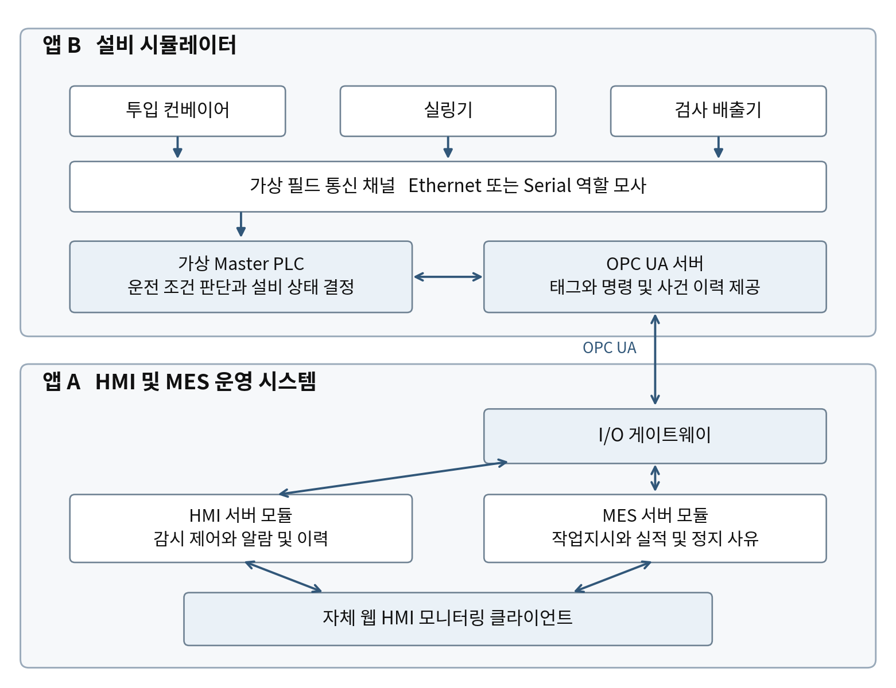

# 가상 설비 연동 HMI 및 MES 시스템 기획서

포장라인 감시 제어와 생산실적 관리

버전 1.0 작성일 2026년 10월 20일

## 01 프로젝트 개요

포장라인의 설비 데이터를 수집하고, 작업자가 웹 HMI에서 운전 상태를 확인하며 명령을 요청하고, 생산 담당자가 작업지시별 실적과 정지 사유를 관리하는 시스템을 개발한다. 하드웨어는 별도로 실행하는 설비 시뮬레이터 앱으로 구현한다.

KULS가 공개한 현장설비, 통신 구간, Master PLC, OPC 서버, HMI 서버, MES 서버, 모니터링 화면의 역할을 개발 범위의 기준으로 삼는다. HMI와 MES는 공통 수집 경로를 사용하고, 가상 PLC가 설비의 실제 상태와 명령 실행 여부를 결정한다. \[S1, S2\]

### 완성 시 보여줄 업무

1.  생산 담당자가 작업지시와 공정 설정을 등록하고 포장라인에 작업을 연결한다.

2.  작업자가 HMI에서 시작을 요청하면 가상 PLC가 준비 조건을 확인하고 설비를 가동한다.

3.  별도 앱에서 고장이나 통신 단절을 발생시키면 HMI의 상태, 알람, 명령 결과와 이력이 대응한다.

4.  생산 사건이 발생 당시 작업에 반영되고, 종료 시 양품과 불량 및 폐기 수량을 대조한 보고서를 확인한다.

### 기본 개발 규모

| **항목**       | **기획 기준**                                             |
|----------------|-----------------------------------------------------------|
| 대상 현장      | 공장 1곳의 포장라인 1개                                   |
| 가상 설비      | 투입 컨베이어, 실링기, 검사 배출기 각 1대                 |
| 연동 구조      | 설비 앱 1개, 가상 Master PLC 1개, OPC UA 서버 1개         |
| 본 시스템      | 웹 HMI, I/O 게이트웨이, HMI 업무와 MES 업무, 데이터베이스 |
| 초기 검증 범위 | 48개 태그, 1초 수집, 동시 사용자 10명                     |
| 최초 완료 수준 | 가상 설비와 실제 OPC UA 통신을 사용하는 통합 검증         |

위 수량과 주기는 개발·검증을 위한 제안값이다. 실제 장비 연결, 특정 PLC 기종 호환성, 현장 성능은 별도의 검증 단계로 관리한다. 모든 수락 시험은 개발 후 실행할 항목이다.

## 02 기업용 시스템과의 대응

KULS HMI 페이지는 실시간 데이터 수집과 상태 확인·제어·이력 관리를 설명하며, 모니터링·알람·트렌드·레포팅을 주요 기능으로 제시한다. 본 기획은 이 네 기능에 구성도의 MES 역할을 더해 한 라인의 운영 업무로 구체화한다. \[S1\]

| **공개 자료**                      | **확인되는 실제 업무**                                           | **기획에 반영할 부분**                          |
|------------------------------------|------------------------------------------------------------------|-------------------------------------------------|
| KULS 온습도 키오스크 설치사례      | 센서와 게이트웨이 수집, 현장 조회, 기준 이탈 경보, 그래프와 이력 | 태그 수집과 현장 화면, 알람 대응, 이력 조회     |
| Adams Group의 Ignition 적용사례    | 배치, 알람, 가동·비가동 시간, 교대 성과, 과거 데이터 조회        | 작업 단위 실적과 정지 이력, 운영자·관리자 화면  |
| California American Water 적용사례 | 설비 감시제어, 알람 통합 목록, 사용자 트렌드와 CSV 내보내기      | 설비 탐색, 사건 전후 추세 비교, 보고서 내보내기 |

위 사례는 각 공급사가 공개한 구축 사례다. 사례의 업무 기능을 참고하며, 공개된 고객사의 규모나 개선 효과를 본 프로젝트의 성능 목표로 사용하지 않는다. \[S3, S4, S5\]

### 시스템 구성예시의 역할 대응

| **원본 구성요소**            | **이번 프로젝트의 구현**                             |
|------------------------------|------------------------------------------------------|
| 현장설비 3개                 | 앱 B의 세 설비 모델과 센서·구동기 상태               |
| 이더넷 또는 Serial           | 가상 필드 통신 어댑터와 연결·지연·단절 상태          |
| Master PLC                   | 앱 B의 운전 상태기계, 명령 허용 조건, 공정 순서 제어 |
| OPC server                   | 실제 통신 가능한 OPC UA 서버와 태그·명령 인터페이스  |
| HMI server와 I/Q server 표기 | 앱 A의 I/O 게이트웨이와 HMI 서버 모듈                |
| MES server                   | 앱 A의 작업지시, 작업 실행, 실적, 정지 사유 모듈     |
| Intouch 모니터링             | 원본의 화면 역할에 대응하는 자체 웹 HMI 클라이언트   |

원본 그림의 OPC 종류와 필드 프로토콜은 특정되어 있지 않다. OPC UA 채택, 포장라인 공정, MES 세부 업무는 이번 기획의 설계 선택이다. 그림에 병렬로 표현된 HMI와 MES의 역할은 유지하되 초기에는 한 운영 백엔드 안에서 모듈로 구분한다. \[S2\]

## 03 전체 시스템 구성

두 앱은 독립적으로 실행하고 서로의 데이터베이스를 직접 읽거나 수정하지 않는다. 앱 사이의 설비 연동은 OPC UA를 통과한다. 본 시스템 내부에서는 I/O 게이트웨이가 수집과 명령 전달을 담당하고 HMI와 MES가 같은 사건을 사용한다.

그림 1 공개 구성예시의 역할을 반영한 개발 구성. 양방향 선은 상태 수집과 명령 요청을 뜻한다. \[S2\]

### 통신 계층의 구현 범위

앱 B 내부의 설비와 가상 PLC 사이에는 필드 통신 어댑터를 둔다. 1차 버전은 가상 채널로 연결 성공, 지연, 읽기 실패를 모사한다. 실제 앱 간 네트워크 검증은 OPC UA 경계에서 수행한다. Modbus TCP나 Serial 드라이버는 이 어댑터를 교체하는 후속 단계이며, 기본 완료 기준에 실제 배선 검증을 포함하지 않는다.

본 시스템의 화면에서 명령을 요청하는 기능과 설비 앱에서 현장 조작을 수행하는 기능을 모두 제공한다. 두 조작이 충돌할 때는 가상 PLC의 현장·원격 모드와 현재 제어 버전이 최종 기준이 된다.

## 04 두 앱의 책임과 적용 공정

| **구분**    | **앱 A HMI 및 MES 운영 시스템**               | **앱 B 설비 시뮬레이터**                            |
|-------------|-----------------------------------------------|-----------------------------------------------------|
| 사용자 목적 | 설비 운전 감시, 명령 요청, 작업과 실적 관리   | 설비 운전 모사, 현장 조작, 고장과 단절 주입         |
| 보유 상태   | 작업지시, 알람 확인, 명령 추적, 실적과 보고서 | 실제 가상 설비 상태, 공정 진행, PLC 상태, 사건 원본 |
| 연동 역할   | OPC UA 클라이언트와 수집·명령 게이트웨이      | OPC UA 서버와 명령 접수·결과 조회                   |
| 저장소      | 운영 PostgreSQL과 게이트웨이 전송 버퍼        | 별도 SQLite에 실행 상태·사건·명령 처리 기록         |
| 독립 실행   | 설비 앱이 꺼져도 이력 조회와 설정 관리 가능   | 본 시스템이 꺼져도 정한 현장 모드로 공정 진행 가능  |

### 포장라인의 동작

투입 컨베이어가 제품을 공급하면 실링기가 온도와 동작 조건에 따라 포장 공정을 수행하고 검사 배출기가 양품 또는 불량으로 판정한다. 각 물품은 투입 시 작업 실행 ID를 부여받아 배출까지 유지한다. 검사 결과는 설비 앱이 생성하며, HMI의 알람 횟수로 불량 수량을 계산하지 않는다.

라인 내부 물품 수인 재공 수량을 보관한다. 일시정지는 같은 작업을 다시 시작할 수 있고, 작업 종료는 신규 투입 중단과 잔류 물품 정리를 거친다. 고장으로 배출할 수 없는 물품은 사유를 기록한 폐기 사건으로 정리한다.

### 사용자와 권한

| **역할**          | **허용 업무**                                             |
|-------------------|-----------------------------------------------------------|
| 조회 사용자       | 현황, 알람 이력, 트렌드, 확정 보고서 조회                 |
| 작업자            | 라인 운전 요청, 알람 확인과 조치 기록, 정지 사유 입력     |
| 생산 담당자       | 작업지시 등록·배포·종료, 품목별 공정 설정 관리, 실적 대조 |
| 설비 관리자       | 태그 매핑, 알람 규칙, 연동 설정, 사용자 권한 관리         |
| 시뮬레이터 조작자 | 별도 앱에서 현장·원격 전환, 센서·고장·통신 시나리오 실행  |

권한 검사는 API에서 수행한다. 공유 화면의 버튼 숨김만으로 제어 권한을 제한하지 않는다. 설비 관리 권한이 생산실적을 직접 수정할 권한을 뜻하지는 않는다.

## 05 필수 기능과 화면

| **ID** | **필수 기능**        | **완료 판단**                                                       |
|--------|----------------------|---------------------------------------------------------------------|
| F01    | 설비 및 태그 등록    | 설비, 주소, 자료형, 단위, 수집 주기, 사용 여부를 저장하고 연결 시험 |
| F02    | 라인 HMI             | 공정도에서 세 설비, 운전 모드, 실시간 값과 데이터 품질 확인         |
| F03    | 운전 명령            | 시작·일시정지·종료·설정·리셋의 요청과 결과 및 거절 사유 추적        |
| F04    | 알람과 조치          | 발생과 복귀, 확인자와 확인 시각, 조치 메모를 사건별 보관            |
| F05    | 트렌드와 이력        | 태그 복수 선택, 기간 조회, 알람 전후 비교, 데이터 누락 표시         |
| F06    | 작업지시와 공정 설정 | 품목, 목표 양품 수량, 라인, 설정 버전을 선택해 실행 연결            |
| F07    | 실적과 작업 종료     | 생산 사건의 중복 제거, 작업 귀속, 최종 수량 대조                    |
| F08    | 정지와 보고서        | 가동·정지·불명 시간, 정지 사유, 일일·작업별 실적과 CSV              |
| F09    | 운영과 감사          | 권한, 설정 변경 이력, 연동 상태, 재시작과 복구 상태                 |
| F10    | 외부 설비 앱         | 독립 실행, OPC UA 제공, 현장 조작과 장애 시나리오                   |

### 화면 구성

| **화면**          | **주요 내용**                                                               |
|-------------------|-----------------------------------------------------------------------------|
| 라인 종합 HMI     | 세 설비 공정도, 현재 작업, 목표·양품·불량, 알람 요약, 마지막 정상 수집 시각 |
| 설비 상세         | 측정값·설정값·품질, 짧은 트렌드, 명령 패널, 최근 고장과 조치                |
| 알람 센터         | 활성 알람과 복귀 미확인, 심각도 필터, 확인과 조치, 관련 트렌드 이동         |
| 작업 운영         | 작업지시 목록, 실행 연결·진행·종료, 실적 대조와 정지 사유                   |
| 트렌드 및 보고서  | 태그 최대 4개 비교, 작업별 실적, 일일 가동 시간과 CSV                       |
| 설정 및 운영 상태 | 태그·규칙·사용자, OPC 연결, 수집 지연, 버퍼, 복구 결과                      |
| 설비 앱 콘솔      | 공정 상태, 현장 조작, 고장·통신 시나리오, 명령 및 사건 원본                 |

웹 HMI의 기본 화면은 1440×900 이상의 PC 화면을 기준으로 한다. 태블릿에는 조회와 알람 확인을 우선 배치한다. 정상 상태는 절제된 색으로 표시하고, 이상과 데이터 불명에는 색과 문자 표식을 함께 사용한다.

## 06 작업 시작부터 종료까지의 흐름

### 정상 생산

1.  생산 담당자가 품목과 공정 설정 버전을 선택하고 목표 양품 수량을 입력해 작업지시를 배포한다.

2.  작업자가 라인 정지와 재공 0, 이전 작업 종료 상태를 확인하고 작업 연결을 요청한다. MES가 execution_id를 만들고 같은 명령 경로로 가상 PLC에 전달한다.

3.  가상 PLC가 작업 ID와 설정을 수락한 후 읽기 결과의 ActiveExecutionId와 RecipeVersion이 일치하면 작업 준비가 완료된다.

4.  작업자가 시작을 요청한다. PLC는 원격 모드, 고장 해소, 가드 닫힘, 예열 완료, 유효 작업 연결을 확인하고 가동한다.

5.  검사 배출기가 생산 사건을 생성한다. I/O 게이트웨이가 사건을 수집하고 MES가 발생 당시 작업에 한 번만 반영한다.

6.  종료를 요청하면 PLC가 신규 투입을 중단하고 잔류 제품을 처리한다. 최종 사건 순번과 수량을 확정하면 MES가 대조 후 작업을 완료한다.

### 고장 대응

설비 앱에서 실링기 고장을 주입하면 가상 PLC가 고장 상태와 원인 코드를 노출한다. HMI에는 고장 알람이 나타나고 MES에는 정지 구간이 생성된다. 작업자는 알람을 확인하고 조치 내용을 기록한다. 설비 앱에서 원인을 해소한 뒤 HMI의 고장 리셋 명령을 별도로 요청한다. 리셋이 성공해도 재가동은 사용자가 다시 요청한다.

### 일시정지와 정상종료의 차이

| **행동**  | **설비 동작**                                            | **MES 처리**                                   |
|-----------|----------------------------------------------------------|------------------------------------------------|
| 일시정지  | 신규 투입을 멈추고 정해진 정지 순서 수행                 | 같은 execution_id를 보존하고 정지 사유 기록    |
| 재개      | 기존 작업과 준비 조건을 확인한 후 가동                   | 같은 작업의 실적과 시간을 이어서 집계          |
| 정상종료  | 투입 중단, 재공 배출 또는 사유 있는 폐기, 최종 경계 확정 | 확정 순번까지 실적 반영 후 작업 완료           |
| 통신 단절 | 가상 설비는 자체 상태에 따라 계속 움직일 수 있음         | 설비 상태를 불명으로 표시하고 실행 결과 재확인 |

화면의 작업 선택 변경은 설비의 작업 교체가 아니다. 작업 변경은 이전 실행 종료와 새로운 작업 연결 명령을 통과해야 한다.

## 07 설비 제어와 명령 처리 규칙

HMI와 MES의 명령은 하나의 명령 서비스와 I/O 게이트웨이를 사용한다. 가상 PLC가 최종 허용 조건과 실행 결과를 판정한다. OPC 요청 접수 성공과 설비 동작 완료를 구분하고, 화면은 실제 피드백을 받아 가동 상태를 갱신한다.

| **명령**       | **PLC의 허용 조건**                                             | **완료 근거**                        |
|----------------|-----------------------------------------------------------------|--------------------------------------|
| LOAD_JOB       | 정지, 재공 0, 이전 실행 종료, 미해결 제어 충돌 없음             | 실행 ID와 설정 버전 일치             |
| START          | 원격, 유효 작업, 가드 정상, 비상정지 해제, 고장 없음, 준비 완료 | 명령 결과 성공과 RUNNING 피드백      |
| PAUSE          | 해당 실행이 가동 중이고 원격 조작 가능                          | 일시정지 상태 피드백                 |
| END_RUN        | 해당 실행 일치, 종료 순서 수행 가능                             | 재공 정리와 최종 수량·사건 순번 확정 |
| SET_PARAMETERS | 허용 범위 안의 값, 작업 시작 전 또는 정의된 정지 상태           | 새 설정 버전과 설정값 읽기 확인      |
| RESET_FAULT    | 원인 신호 해소, 비상정지 해제, 리셋 가능한 고장                 | 고장 해제 피드백, 자동 재기동 없음   |

### 명령의 상태

요청됨 → 전달됨 → 접수됨 → 실행 성공 또는 실행 실패로 진행한다. 허용 조건 위반은 거절, 전달 전 유효기간 경과는 만료로 기록한다. 전달 뒤 응답이 끊겨 실행 여부를 알 수 없으면 결과 확인 필요 상태로 둔다.

- 각 명령에 command_id, 대상, execution_id, 인자, 요청자, 요청 시각, 유효기간, expected_control_version을 기록한다.

- 동일 ID와 동일 내용은 기존 결과를 반환한다. 동일 ID의 다른 내용은 거절한다. 설비 앱은 이 기록을 재시작 후에도 유지한다.

- 결과가 불명일 때 새 ID로 자동 재실행하지 않는다. 기존 ID로 결과를 조회하고 현재 설비 상태와 대조한다. 제어 버전은 제어 상태나 작업 변경 시에만 증가한다.

- 전달 대기 명령의 기본 유효기간은 5초다. 접수 후 실행 대기는 시작 10초, 정상종료 60초를 시험값으로 둔다. 초과하면 실패를 단정하지 않고 결과를 확인한다.

- 통신 복구 후 만료된 시작·설정 명령을 실행하지 않는다. 처리 미정인 명령이 있으면 충돌하는 시작·작업교체를 제한한다.

현장·원격 선택, 비상정지 입력, 가드 신호의 최종 상태는 설비 앱에 둔다. HMI의 알람 확인은 사용자의 확인 기록이며, 고장 리셋이나 비상정지 해제를 대신하지 않는다.

## 08 태그와 데이터 품질

태그는 설비의 값 하나를 이름·자료형·단위·주소와 함께 정의한 항목이다. 수집값에는 source_timestamp, 수집 시각, 서버 저장 시각, 원본 품질과 화면의 최신성 상태를 보존한다. OPC UA의 DataValue는 값, 상태 코드, 원천·서버 시각을 구분한다. \[S7\]

| **그룹**      | **태그 수** | **구성**                                                               |
|---------------|-------------|------------------------------------------------------------------------|
| 라인          | 18          | 운전·제어 모드, 허용 조건, 작업 ID, 수량, 재공, 생존 신호와 제어 버전  |
| 투입 컨베이어 | 8           | 상태, 운전 피드백, 고장, 전류, 속도, 입구 센서, 대기 수량, 생존 신호   |
| 실링기        | 12          | 상태와 고장, 전류·속도, 온도와 설정, 히터, 압력, 가드, 준비, 생존 신호 |
| 검사 배출기   | 10          | 상태와 고장, 전류·속도, 배출 센서, 판정, 양품·불량 카운터, 생존 신호   |

### 수집과 최신성 판정

기본은 OPC UA에서 1초마다 태그를 묶어서 읽는다. 원본 값이 변하지 않아도 정상 읽기와 생존 신호가 이어지면 연결 상태를 정상으로 본다. SourceTimestamp는 값이나 상태가 마지막으로 바뀐 시각일 수 있으므로 그것만으로 통신 단절을 판정하지 않는다. \[S7\]

| **상황**                            | **표시와 계산 규칙**                                     |
|-------------------------------------|----------------------------------------------------------|
| 정상 값과 정상 생존 신호            | 현재 값으로 표시하고 알람·시간 계산에 사용               |
| 원본 Bad 또는 Uncertain             | 원인과 품질을 표시하고 정상 값으로 계산하지 않음         |
| 3초간 정상 수집 또는 생존 신호 없음 | 지연 표시와 함께 마지막 정상 시각 제시, 충돌성 제어 제한 |
| 5초 이상 지속                       | 통신 이상 알람, 가동 상태 불명, 활성 설비 알람은 유지    |
| 소스 연결 복구                      | 새 값과 실행·명령·순번 대조 후 제어 가능 상태로 복귀     |
| 오래된 재전송 데이터                | 이력에는 반영하되 최신 화면 값을 과거로 되돌리지 않음    |

시각은 UTC로 저장하고 화면과 일일 보고서는 Asia/Seoul 기준으로 계산한다. 수집기 시계가 역행하거나 허용 오차 2초를 넘으면 시간 품질 경고를 남기고 해당 구간의 시간 집계를 확정하지 않는다. 이 값은 초기 시험 설정이며 현장 요구에 맞게 조정한다.

1초보다 짧은 센서 펄스는 폴링만으로 보장하지 않는다. 생산 수량은 가상 PLC가 생성한 누적 카운터와 영속 사건 이력으로 보완한다. 전류 0이나 값 미변화만으로 설비 정지·센서 고장을 단정하지 않는다.

## 09 알람과 현장 조치

알람은 조건의 발생·복귀와 사용자의 확인을 독립적으로 기록한다. Ignition의 공식 알람 모델도 이 두 상태를 구분한다. 본 시스템은 이를 사건별 이력과 조치 화면에 반영한다. \[S6\]

| **조건**  | **사용자 확인**    | **화면 상태** |
|-----------|--------------------|---------------|
| 이상 지속 | 아직 확인하지 않음 | 발생 미확인   |
| 이상 지속 | 확인함             | 발생 확인     |
| 정상 복귀 | 아직 확인하지 않음 | 복귀 미확인   |
| 정상 복귀 | 확인함             | 복귀 확인     |

### 초기 알람 종류

| **알람**            | **발생 기준**                            | **복귀 기준**                        |
|---------------------|------------------------------------------|--------------------------------------|
| PLC 고장            | FaultCode가 0이 아님                     | PLC가 원인 해소와 리셋 완료를 통지   |
| 실링 온도 이탈      | 생산 중 설정 대비 ±10℃ 이탈이 5초 지속   | 설정 대비 ±7℃ 안으로 5초 유지        |
| 공압 부족           | 생산 중 설정한 하한 미달이 3초 지속      | 복귀 하한 이상으로 3초 유지          |
| 통신 이상           | 정상 수집 또는 생존 신호가 5초 이상 없음 | 새로운 정상 값과 연결 상태 확인      |
| 명령 결과 확인 필요 | 전달된 명령의 결과 확인 기한 초과        | 원래 명령 ID의 결과와 상태 대조 완료 |

온도와 압력의 수치·지속시간은 시뮬레이터 검증을 위한 예시다. 실제 공정의 허용 범위는 설비 사양과 품목 조건으로 교체한다. 예열 단계는 생산 중 온도 이탈 규칙과 구분한다.

### 이력 보존과 화면 동작

- 동일 이상이 지속되는 동안 사건 하나를 유지한다. 정상 복귀 후 재발하면 새 사건을 만든다.

- 발생·복귀 시각, 측정값, 규칙 버전, 심각도, 확인자와 시각, 조치 메모를 보존한다. 메모 수정도 수정 전후 이력을 남긴다.

- 통신 단절 동안 기존 알람을 자동 복귀시키지 않는다. 데이터 품질이 회복되면 새 정상 관측으로 조건을 다시 판단한다.

- 설정 변경으로 알람이 종료되면 설정 변경에 따른 종료로 기록한다. 설비가 정상으로 돌아온 사건과 구분한다.

- 알람을 선택하면 관련 설비와 사건 전후 트렌드로 이동한다. 늦게 복원된 과거 사건은 지연 수신 표식을 붙인다.

## 10 MES 작업지시와 생산실적

### 작업지시와 실행 단위

작업지시는 품목, 목표 양품 수량, 라인, 공정 설정 버전, 예정일을 가진다. 최초 버전에서는 라인당 실행 작업 하나만 허용한다. 동일 작업의 일시정지와 재개는 같은 execution_id를 유지한다. 다른 작업으로 전환할 때 새로운 ID를 만든다.

| **업무 상태**         | **전환 조건**                                                                  |
|-----------------------|--------------------------------------------------------------------------------|
| 작성 중               | 필수 항목과 품목별 공정 설정을 작성                                            |
| 배포됨                | 생산 담당자가 배포하고 작업자가 선택 가능                                      |
| 준비 중               | LOAD_JOB 요청과 PLC의 작업 연결 확인 진행                                      |
| 진행 중 또는 일시정지 | 연결된 실행에서 가동 또는 정지 피드백 수신                                     |
| 종료 대기             | PLC가 투입 중단과 재공 정리를 수행하고 수량 대조 진행                          |
| 완료                  | 최종 순번까지 사건 반영, PLC 최종 수량과 대조 일치                             |
| 취소                  | 미연결 작업은 즉시 취소. 연결 요청 이후에는 결과 확인과 실행 종료 후 취소 확정 |

LOAD_JOB 전달 이후에는 원래 명령 결과를 확인하고, 연결된 실행을 END_RUN으로 종료한 뒤 취소를 확정한다. 확인 중 신규 시작은 막는다. 경합으로 생산이 발생했다면 취소 대신 실적을 보존한 종료 절차를 수행한다.

### 생산 수량의 기준

MES 실적의 기준은 검사 배출기에서 발생한 생산 사건이다. 사건에는 event_id, execution_id, 설비 ID, 순번, 발생 시각, 판정, 수량을 기록한다. 양품·불량·재공 폐기를 서로 다른 유형으로 보관한다. PLC 누적 카운터는 사건 합계와 대조하는 용도로만 사용하고 실적에 다시 더하지 않는다.

- event_id에 중복 방지 제약을 두어 재전송을 한 번만 반영한다. 사건을 받은 시점의 화면 선택 작업에 붙이지 않는다.

- 품질 판정은 설비 앱의 검사 모델에서 생성한다. 운영 앱에서 알람 유무로 양품이나 불량을 추정하지 않는다.

- 카운터가 감소하면 재시작·초기화 여부를 counter_epoch로 확인한다. 원인을 확인하지 못하면 실적 대조를 보류한다.

- 수량은 정수 개 단위로 관리한다. 동일 실행의 투입 수량은 양품, 불량, 재공 폐기, 현재 재공의 합계와 대조한다.

### 공정 설정

품목별 실링 온도와 라인 속도를 설정 버전으로 보관한다. 생산에 사용된 버전과 값을 실행 기록에 고정한다. 실행 중 임의 덮어쓰기는 허용하지 않으며, 허용된 정지 상태에서 변경할 경우 새 설정 버전과 적용 시점을 남긴다.

## 11 작업 전환과 보고서의 정합성

### 작업 종료 경계

1.  PLC가 신규 투입을 중단하고 기존 execution_id를 유지한다.

2.  잔류 제품을 검사 배출하거나, 고장 등으로 처리할 수 없는 물품을 사유 있는 재공 폐기 사건으로 정리한다.

3.  PLC가 재공 0을 확인하고 실행의 최종 양품·불량·폐기 수량과 마지막 사건 순번을 고정한다.

4.  MES가 해당 순번까지 사건을 수신하고 중복을 제거한 합계를 대조한다. 누락이나 불일치가 있으면 종료 대기로 둔다.

5.  대조가 완료된 뒤 다음 작업의 execution_id를 전달한다. 이전 작업의 중복 사건이 늦게 도착해도 원래 작업에만 귀속된다.

### 정지 시간과 정지 사유

가동 여부는 PLC의 라인 상태를 기준으로 계산한다. RUNNING은 가동, 그 밖의 알려진 상태는 정지로 분류하고 정지 상태 코드를 함께 남긴다. 통신·시간 품질 때문에 알 수 없는 구간은 불명 시간으로 둔다. 정지 사유는 자재 대기, 설비 문제, 작업 전환, 계획 정지, 미분류에서 선택하고 작업자가 보완한다.

기간 합계는 가동 시간 + 정지 시간 + 불명 시간으로 검산한다. 비율은 가동 시간 ÷ 보고 대상 전체 시간으로 표시하고 불명 비율을 함께 보여준다. 확정하지 못한 시간을 분모에서 감춰 가동률을 높이지 않는다.

### 보고서

| **보고서**       | **포함 항목**                                                             |
|------------------|---------------------------------------------------------------------------|
| 작업별 실적      | 작업·실행 ID, 품목과 설정 버전, 목표·양품·불량·폐기, 시작·종료, 대조 상태 |
| 일일 운영        | 가동·정지·불명 시간, 정지 사유별 합계, 양품·불량, 미확인 알람             |
| 알람과 명령 이력 | 발생·복귀·확인·조치, 요청자·명령·인자·결과, 지연 수신 여부                |
| 설비 트렌드      | 선택 태그, 단위, 기간, 원본·집계 구분, 품질과 데이터 누락                 |

일일 경계는 한국 시간 00시부터 다음 날 00시까지다. 날짜를 넘는 작업은 작업 보고서에서는 한 실행으로, 일일 보고서에서는 해당 날짜의 사건과 시간 구간으로 나눈다. 교대 보고는 교대 시간표가 등록된 이후 확장한다.

초기 보고서는 처리 수량, 가동·정지와 데이터 관측 상태를 제공한다. OEE는 계획 생산시간, 이상적 사이클, 양품 기준이 합의된 후 별도로 추가한다.

## 12 설비 시뮬레이터 앱 기획

설비 앱은 공정을 스스로 진행시키는 상태기계를 가진다. 화면 버튼이나 시나리오 입력이 센서와 현장 조건을 바꾸면 가상 PLC가 운전 상태를 다시 판단하고, 그 결과가 OPC UA를 통해 본 시스템에 전달된다. 두 앱의 화면이 같은 변수를 직접 공유하지 않는다.

### 설비 모델의 규칙

- 가상 공정은 기본 100ms 간격으로 진행하고, 시연의 기준 속도는 실제 시간 1배로 한다. 이 주기는 소프트웨어 모사 주기이며 실제 PLC 실시간 성능을 뜻하지 않는다.

- 실링 온도는 히터 상태에 따라 상승하거나 하강하고, 모터 운전 상태에 따라 속도와 전류가 바뀐다. 조건이 충족되지 않으면 PLC가 시작을 거절한다.

- 검사 결과는 재현 가능한 시나리오 순서와 seed로 생성한다. 수량 시험은 정해진 양품·불량 순서를 사용해 기대 결과를 미리 계산한다.

- 작업 실행, 재공 물품, 누적 수량, 사건 순번, 처리한 명령 ID는 저장한다. 재시작 시 RECOVERY_REQUIRED로 시작해 작업과 미완료 명령을 대조한 후 재개한다.

수량에 영향을 주는 공정 전이에서는 물품·재공 상태, 누적 수량, 원본 생산 사건과 사건 순번을 같은 트랜잭션으로 확정한다. 명령의 실행 성공 결과도 완료를 결정하는 제어 상태와 함께 확정한다. 확정 중 중단되면 전체가 반영되거나 전체가 미반영된 상태로 복구한다.

### 별도 앱의 조작 기능

| **분류**        | **조작 항목**                                                         |
|-----------------|-----------------------------------------------------------------------|
| 현장 조작       | LOCAL 또는 REMOTE, 운전 모드, 현장 시작·정지, 비상정지 입력과 해제    |
| 설비 조건       | 가드 개방, 자재 부족, 모터 고장, 온도 편차, 공압 저하, 검사 결과 순서 |
| 필드 통신       | 설비별 지연, 읽기 실패, 연결 단절, 오래된 값과 품질 오류              |
| OPC와 서버 연결 | OPC 연결 차단, 응답 지연, 명령 실행 직후 응답 유실                    |
| 복원 시험       | 사건 중복·지연 전달, 카운터 초기화, 앱·게이트웨이 재시작              |
| 검증 조회       | 원본 사건 순번과 수량, 현재 실행, 명령 접수·실행 로그                 |

### 통합 시연 시나리오

작업 A를 연결해 정상 생산한다. 실링기 고장을 주입하고 HMI에서 확인·조치·리셋·재개를 수행한다. 명령 실행 직후 응답을 끊어 결과 확인 필요 상태를 확인한다. 재접속 후 원래 명령 결과를 복원하고, 작업 A를 정산한 뒤 작업 B로 전환한다. 작업 A의 중복 사건을 다시 전달하여 A와 B의 실적이 섞이지 않는지 확인한다.

시뮬레이터의 센서·고장 조작은 시험 환경에 명확히 표시한다. 실제 설비 연동 단계에서는 동일 자리에 현장 어댑터가 들어가며 시험 조작 기능을 운영 화면에 노출하지 않는다.

## 13 인터페이스와 저장 구조

### 앱 사이의 계약

| **인터페이스**   | **내용**                                         | **처리 규칙**                                |
|------------------|--------------------------------------------------|----------------------------------------------|
| 태그 읽기        | OPC UA DataValue와 공정·설비 태그                | 값, 원본 품질, 시각, 생존 신호 보존          |
| SubmitCommand    | ID, 실행, 명령 종류, 인자, 제어 버전, 만료 시각  | 접수·거절을 반환하고 실행 결과는 별도로 조회 |
| GetCommandResult | command_id 기준 결과 조회                        | 재연결과 재시작 후에도 기존 결과 조회        |
| ReadEvents       | after_seq 이후 생산·상태·고장 사건과 페이지 경계 | 순번으로 누락 확인, 원본 ID로 중복 제거      |
| GetRunSummary    | 실행 상태, 최종 수량과 마지막 사건 순번          | 종료 전후 실적 대조                          |

위 메서드와 사건 스키마는 본 프로젝트의 OPC UA 애플리케이션 계약이다. 표준 OPC UA 기능 위에 정의하며, 다른 제조사 PLC가 같은 메서드를 제공한다고 가정하지 않는다. 실제 장비는 어댑터에서 계약으로 변환한다.

### 주요 저장 항목

| **묶음**    | **핵심 레코드와 관계**                                                                       |
|-------------|----------------------------------------------------------------------------------------------|
| 설비와 설정 | sites, lines, assets, tag_definitions, alarm_rules, recipe_versions                          |
| 수집과 이력 | tag_latest, tag_samples, minute_aggregates, equipment_state_events, connection_intervals     |
| 알람과 명령 | alarm_instances, alarm_actions, control_commands, command_results, audit_logs                |
| 생산 운영   | work_orders, production_executions, production_events, downtime_reasons, run_reconciliations |

production_events는 execution_id를 반드시 참조한다. event_id와 명령 ID에 고유 제약을 둔다. 원본 사건·명령·감사 이력은 일반 수정·삭제 화면을 제공하지 않고, 추가 조치나 정정 근거를 별도 기록한다.

### 백엔드 처리 원칙

수집 배치는 데이터와 처리 순번을 같은 트랜잭션으로 확정한 후 수신 확인을 보낸다. HMI와 MES는 이 확정된 사건을 함께 사용한다. 현재 태그, 활성 알람, 미완료 명령은 재시작 후 저장 상태와 설비를 대조해 복원한다.

HMI와 MES 모듈은 처음에는 하나의 운영 API에 두고, I/O 게이트웨이만 독립 프로세스로 실행한다. 여러 물리 서버나 메시지 브로커는 측정된 병목 또는 운영 요구가 생길 때 분리한다.

## 14 보관과 장애 복구 및 운영

### 수집 중단과 복구

I/O 게이트웨이는 읽은 데이터를 로컬 버퍼에 저장한 뒤 운영 서버로 전달한다. 운영 서버와의 연결이 끊기면 30분 또는 100MB 중 먼저 도달하는 한도까지 보관한다. 한도를 넘으면 오래된 미전송 구간의 범위를 기록하고 최근 데이터를 유지한다. 누락을 숨기지 않고 운영 경보를 발생시킨다.

OPC 서버와의 연결 자체가 끊긴 동안에는 아날로그 측정값을 만들지 않는다. 설비 앱에 남아 있는 생산·상태 사건은 ReadEvents로 다시 읽는다. 이벤트 로그 보관기간은 7일로 설정하고, 이미 삭제된 순번이 필요하면 명시적인 복구 불가 응답을 반환한다.

복구 데이터는 원본 시각과 순번으로 반영한다. 과거 알람은 지연 수신으로 기록하고 한꺼번에 현재 알림으로 재생하지 않는다. 복구가 끝났을 때 여전히 활성인 알람은 현재 목록에 표시한다. 복구 중에는 최신성 표시와 제어 제한을 유지한다.

### 초기 보관 정책

| **데이터**               | **보관 기준**         | **조회 규칙**                                           |
|--------------------------|-----------------------|---------------------------------------------------------|
| 아날로그 원시값          | 9개 태그의 1초 값 7일 | 원본 시각과 품질 포함                                   |
| 1분 집계                 | 90일                  | 최소·최대·평균·마지막값과 유효 수·예상 수 보관          |
| 생산·알람·명령·감사 사건 | 180일                 | 미완료 작업과 미해결 사건은 기간 도달 시 자동 삭제 금지 |
| 시뮬레이터 원본 사건     | 7일                   | 누락 순번 재조회, 보관 경계 반환                        |
| 현재 상태와 설정         | 활성 동안 보관        | 버전과 적용 이력 보존                                   |

9개 아날로그 태그를 1초마다 7일 저장하면 최대 5,443,200개 표본이 생긴다. 실제 저장 용량은 인덱스와 필드 크기에 따라 측정한다. 단위가 다른 값을 같은 축에 섞지 않고, 누락 구간을 정상 측정선으로 연결하지 않는다.

### 배포와 유지관리

운영 API와 웹, I/O 게이트웨이, PostgreSQL, 설비 앱을 Docker Compose 실행 구성으로 제공한다. 두 앱은 별도 실행도 가능해야 한다. 상태 확인 항목은 서버 응답, DB, OPC 연결, 마지막 정상 수집, 버퍼 사용량, 미정 명령, 사건 누락이다.

매일 DB와 설정을 백업하고 별도 디렉터리로 복원해 작업·알람·명령 상태를 검산한다. 제어 세션에는 사용자 인증을 적용하고, OPC UA는 신뢰한 인증서와 정해진 명령 목록을 사용한다. 실제 장비를 연결할 때도 제어 경로와 현장 운전 조건을 유지한다.

## 15 기술 구성과 확장 경계

| **영역**         | **제안 기술**                       | **선택 이유**                                           |
|------------------|-------------------------------------|---------------------------------------------------------|
| 본 시스템 화면   | React와 TypeScript                  | 공정도, 표, 실시간 값과 상태를 구성 요소로 관리         |
| 운영 API         | Python과 FastAPI                    | HMI·MES 업무와 수집 계약을 한 언어로 관리               |
| I/O와 가상 OPC   | Python과 asyncua                    | OPC UA 서버·클라이언트와 애플리케이션 메서드 구현       |
| 운영 저장소      | PostgreSQL                          | 작업 관계와 중복 방지 제약, 사건과 시계열 저장          |
| 별도 앱 저장소   | SQLite                              | 설비 앱과 게이트웨이의 독립 상태·버퍼 유지              |
| 화면 갱신        | HTTP API와 WebSocket                | 초기 전체 상태 조회 후 변경 전달, 재접속 시 다시 동기화 |
| 로컬 실행과 검증 | Docker Compose와 로컬 시험 스크립트 | 본앱과 설비앱을 함께 또는 따로 실행                     |

asyncua는 OPC UA 서버와 클라이언트를 제공하는 공개 프로젝트다. 패키지 버전은 개발 시작 시 읽기·메서드·인증서 시험을 통과한 조합으로 고정한다. 위 기술은 제안안이며 KULS의 내부 개발 스택을 뜻하지 않는다. \[S8\]

### 이 버전에서 완성할 범위

프로토콜을 통과하는 양방향 제어, PLC의 허용 조건 판단, 알람 대응, 태그 이력, 작업별 실적 정합성, 장애 복구, 운영 이력까지를 최초 릴리스 범위로 잡는다. 화면만 먼저 완성한 상태와 전체 통합 검증을 마친 상태는 별도로 표시한다.

### 후속 확장

| **확장**                           | **착수 조건**                                          |
|------------------------------------|--------------------------------------------------------|
| 실제 Modbus TCP 또는 Serial 어댑터 | 연결할 장비 주소·자료형·통신 규격과 쓰기 조건 확보     |
| 여러 라인과 현장                   | 한 라인의 수집·제어·작업 정합성 검증 통과              |
| OEE와 교대 분석                    | 생산 달력, 이상적 사이클, 교대 시간표와 수량 기준 합의 |
| 실제 PLC 및 상용 HMI 연계          | 장비 접근 가능, 태그맵·제어 조건·통신 라이선스 확인    |
| 예지보전                           | 고장과 정비 이력, 라벨과 충분한 관측 데이터 확보       |
| 이중화                             | 허용 중단 시간과 데이터 손실 목표가 요구사항으로 확정  |

생산계획 최적화, BOM·구매·원가, WMS 전체, 3D 시뮬레이션, AI 예측은 별도 확장이다. 현재 프로젝트의 기업 업무 적합성은 설비와 운영 데이터가 일관되게 연결되는지로 판단한다.

## 16 수락 시험과 검증 목표

아래 시험은 개발 후 통과해야 할 기준이다. 설비 앱의 원본 로그, 본 시스템 저장 기록, 화면, 보고서를 동일 실행 ID와 사건·명령 ID로 대조한다.

| **ID** | **시험**              | **통과 기준**                                                |
|--------|-----------------------|--------------------------------------------------------------|
| T01    | 정상 작업 시작과 종료 | 세 설비가 순서대로 동작하고 실적·최종 수량·설정 버전 일치    |
| T02    | 시작 조건 위반        | 가드 개방·LOCAL·미예열 상태에서 PLC 거절, HMI 가동 표시 없음 |
| T03    | 명령 응답 유실        | 실행 직후 연결 단절 후 원래 ID로 결과 복원, 중복 동작 없음   |
| T04    | 알람 확인과 복귀 순서 | 확인 먼저·복귀 먼저 모두 네 상태와 이력 보존                 |
| T05    | 고장 원인 지속        | 알람 확인 후에도 리셋 거절, 실제 고장 상태 유지              |
| T06    | 필드 또는 OPC 단절    | 3초 지연·5초 통신 알람, 값 0이나 정상 복귀로 치환하지 않음   |
| T07    | 생산 사건 재전송      | 동일 사건 반복·지연 수신 시 수량이 한 번만 증가              |
| T08    | 작업 전환과 재공      | 종료 경계 확인, A의 지연·중복 사건이 B에 반영되지 않음       |
| T09    | 배출 확정 중 앱 중단  | 물품·수량·사건 일치, 명령·알람 복원, 자동 재가동 없음        |
| T10    | 버퍼와 원본 이력 복구 | 한도 안의 사건 복구, 초과 누락 구간과 영향 명시              |
| T11    | 보고서 검산           | 가동+정지+불명=대상 시간, 사건 합계=확정 PLC 수량            |
| T12    | 권한과 복원           | 조회 사용자 제어 거절, 백업 복원 후 주요 상태 대조 일치      |

### 성능 시험 조건

| **항목**  | **검증 목표**                                              |
|-----------|------------------------------------------------------------|
| 실행 환경 | 로컬 4코어, 메모리 8GB 이상, SSD. 실제 사양과 버전 기록    |
| 부하      | 48개 태그 1초 수집, 동시 사용자 10명, 8시간 연속 모의 운전 |
| 화면 지연 | 정상 연결 상태의 PLC 변화부터 표시까지 p95 2초 이하        |
| 알람 지연 | 규칙의 지속시간 충족부터 화면 표시까지 p95 3초 이하        |
| 조회      | 7일 이력에서 태그 4개·24시간 구간 집계 조회 p95 3초 이하   |
| 복구      | 30분 버퍼를 재연결 후 5분 안에 반영하고 최신 상태로 복귀   |

측정 결과에는 표본 수, 지연 분포, 누락과 중복, CPU·메모리·DB 용량을 기록한다. 기준을 달성하지 못하면 수집 주기나 처리 방식을 조정한 후 해당 시험을 다시 수행한다.

## 17 단계별 개발 순서와 완료 산출물

| **단계**    | **개발 내용**                                         | **완료 산출물과 판단**                       |
|-------------|-------------------------------------------------------|----------------------------------------------|
| 1 계약 확정 | 48개 태그, 상태·명령·사건, 작업 종료 경계 정의        | 태그 사전과 명령·사건 스키마, 정상·오류 예시 |
| 2 설비 앱   | 세 설비 모델, 필드 채널, 가상 PLC, OPC 서버와 조작 UI | 단독 운전과 고장 주입, 원본 사건·명령 로그   |
| 3 연동 경로 | I/O 게이트웨이, 저장·재전송, 명령 접수와 결과 조회    | 읽기·명령·재시작 경로 통합 시험              |
| 4 HMI 업무  | 공정도, 상세, 알람, 트렌드, 명령 추적과 권한          | 정상·고장·단절이 연결된 운영 화면            |
| 5 MES 업무  | 작업지시·설정, 실행 귀속, 실적과 정지 사유, 종료 정산 | 작업 A와 B 전환 및 보고서 검산               |
| 6 운영 검증 | 부하·복구·권한·백업, 설치와 운영 문서                 | T01부터 T12 결과와 재현 가능한 시연 구성     |

첫 구현은 태그 계약과 두 앱 사이의 한 개 읽기·명령 경로부터 시작한다. 이후 기능을 추가할 때마다 같은 경로에서 결과를 검증한다. 예상 일정은 단계 3의 연동 난이도를 확인한 뒤 산정하며, 각 단계의 완료 기준으로 진행 상태를 관리한다.

### 최종 제공물

- 본 운영 앱과 별도 설비 앱의 소스, 독립 실행 구성, 설정 예시

- 태그 사전, OPC UA 계약, 명령·알람·작업 상태 정의

- 정상 운전, 고장, 단절, 명령 결과 불명, 작업 전환 시험 데이터

- 설치·시작·중지·백업·복원 절차와 권한 안내

- 수락 시험 결과, 성능 측정 결과, 실행 ID로 추적 가능한 시연 기록

### 개발 완료와 현장 적용의 구분

이 계획의 최초 완료 상태는 가상 설비·PLC·OPC UA를 통한 HMI와 MES 통합 검증이다. 이후 실제 장비를 선정하면 태그 주소·품질·카운터·명령 응답·운전 조건을 맞추고, 해당 장비와 제한된 현장 조건에서 별도 검증한다. 그 결과를 확보한 범위에 한해 실제 설비 연동 완료로 표시한다.

확인할 현장 항목은 설비와 PLC 기종, OPC 또는 필드 프로토콜, 태그맵, 설정값 범위, 운전 권한, 생산·불량 판정 신호, 작업 종료 기준이다. 이 항목은 실제 장비를 연결하는 시점에 구체화하며, 두 앱을 이용한 개발 착수의 선행 조건은 아니다.

## 18 태그 사전 초안

아래 이름은 본 프로젝트의 논리 태그명이다. 실제 OPC NodeId는 주소 공간 생성 시 고정하고 태그 정의에 저장한다. 값을 읽는 태그와 명령 메서드를 구분하며, 측정·수량 태그를 직접 써서 설비 상태를 바꾸지 않는다.

| **그룹**   | **태그명**                                     | **자료형과 단위**               |
|------------|------------------------------------------------|---------------------------------|
| Line 18    | State, ControlMode, OperationMode              | Int32 열거값                    |
|            | EStop, GuardClosed, Permissive                 | Boolean                         |
|            | FaultCode                                      | UInt32                          |
|            | ActiveExecutionId, RecipeVersion, CounterEpoch | String                          |
|            | TargetQuantity, WipCount                       | UInt32 개                       |
|            | GoodTotal, RejectTotal, ScrapTotal             | UInt64 개                       |
|            | Heartbeat, ControlVersion, EventSeq            | UInt64                          |
| Infeed 8   | State, RunFeedback, FaultCode                  | Int32, Boolean, UInt32          |
|            | MotorCurrent, ActualSpeed                      | Double A, m/min                 |
|            | EntrySensor, BufferCount, LinkHeartbeat        | Boolean, UInt32 개, UInt64      |
| Sealer 12  | State, RunFeedback, FaultCode                  | Int32, Boolean, UInt32          |
|            | MotorCurrent, ActualSpeed                      | Double A, m/min                 |
|            | TemperaturePV, TemperatureSP, AirPressure      | Double ℃, ℃, bar                |
|            | HeaterOn, GuardClosed, Ready, LinkHeartbeat    | Boolean 3개, UInt64             |
| Outfeed 10 | State, RunFeedback, FaultCode                  | Int32, Boolean, UInt32          |
|            | MotorCurrent, ActualSpeed                      | Double A, m/min                 |
|            | ExitSensor, CheckResult                        | Boolean, Int32 미판정·양품·불량 |
|            | GoodCounter, RejectCounter, LinkHeartbeat      | UInt64 3개                      |

자료형 합계는 48개이며, 아날로그 이력 대상은 전류 3개, 속도 3개, 온도 2개, 압력 1개로 총 9개다. 상태·수량·생존 신호는 최신값과 변화 사건을 보관한다.

라인 운전 상태는 STOPPED, READY, RUNNING, PAUSED, STOPPING, FAULT, ESTOP, RECOVERY_REQUIRED로 정의한다. 통신으로 알 수 없는 상태인 UNKNOWN은 본 시스템의 표시 상태다. 가상 PLC의 실제 상태를 UNKNOWN으로 덮어쓰지 않는다.

## 19 참고 자료

열람일은 2026년 10월 20일이다. S1과 S2는 기획 기준이 된 제품 설명·구성도, S3부터 S5는 공급사가 공개한 적용 사례, S6부터 S8은 기술 설계의 참고 문서다.

**S1 KULS 모니터링 및 IoT 솔루션**

https://www.kuls.co.kr/ict/kict/ict_smartfactory_hmi.php

모니터링, 알람, 트렌드, 레포팅과 설비 상태 확인·제어·이력 관리의 기능 범주.

**S2 KULS HMI 시스템 구성예시**

https://www.kuls.co.kr/ict/inc/themes/kweb/img/hmi-sec2-system.png

현장설비와 통신 구간, Master PLC, OPC 서버, HMI·MES 서버 및 모니터링 화면의 관계.

**S3 KULS 온습도 모니터링 키오스크 설치사례**

https://www.kuls.co.kr/kor/kbrd/kbrd_view.php?board_id=INSIGHT_CASE&cid=106

구역별 센서, 게이트웨이·서버, 현장 조회, 기준 이탈 경보, 이력·리포트.

**S4 Inductive Automation Adams Group 적용사례**

https://inductiveautomation.com/resources/casestudy/two-plants-one-solution

배치, 알람, 가동·비가동 시간, 교대 성과, 과거 데이터의 실제 조회 업무. 문서 갱신 2022년 5월 5일.

**S5 Inductive Automation California American Water 적용사례**

https://inductiveautomation.com/resources/casestudy/water-utility-implements-ignition-system-to-improve-efficiency-compliance-and-reporting

감시제어, 알람 목록, 태그 트렌드와 데이터 내보내기. 문서 갱신 2026년 7월 24일.

**S6 Ignition 공식 Alarming 문서**

https://docs.inductiveautomation.com/docs/8.3/platform/alarming

알람 발생·복귀와 사용자 확인 상태의 분리.

**S7 OPC Foundation DataValue 및 SourceTimestamp 정의**

https://reference.opcfoundation.org/specs/OPC-10000-4/7.11
https://reference.opcfoundation.org/specs/OPC-10000-4/7.11.3

값, 상태 코드, 원천 시각과 서버 시각을 구분하는 데이터 모델.

**S8 FreeOpcUa asyncua 공식 저장소**

https://github.com/FreeOpcUa/opcua-asyncio

Python용 OPC UA 서버와 클라이언트 구현 참고.
